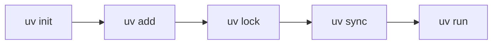

This lecture shows every content block available in the editor. Turn on **Edit mode** and open any section with its pencil to see how each block is written, or use **+ Insert block** in the editor toolbar.

## Step 1: Callouts

::: objective
Recognise each callout type and know when to use it.
:::

::: prereq
A terminal, Python 3.12 and uv installed.
:::

::: info
Neutral background information the learner may need.
:::

::: tip
A shortcut or smarter way to do something.
:::

::: important
Something the learner must not skip.
:::

::: best
Use `uv add` for project dependencies instead of `pip install`.
:::

::: mistake
Running `uv sync` outside the project folder installs nothing useful.
:::

::: warning
This command overwrites existing files.
:::

::: danger
Never commit your `.env` file. It contains real API keys.
:::

::: definition Lockfile
A file that records the exact version of every installed package so every machine gets the same environment.
:::

::: takeaway
Python runs your code; uv prepares where it runs.
:::

::: exercise
Create a new project called `practice` and add the `rich` package to it.
:::

::: question
What is the difference between `uv add` and `uv pip install`?
:::

::: success
Your environment is ready.
:::

::: example
`uv run python main.py` runs a file inside the project environment.
:::

::: note {color=purple icon=rocket} Custom color and icon
Any callout can take a color and an icon: `{color=purple icon=rocket}`.
:::

## Step 2: Collapsible and quotes

### Collapsible sections

::: question
Which file should you never edit by hand?
:::

::: answer
`uv.lock`. Let uv update it with `uv add`, `uv remove` or `uv lock`.
:::

::: solution
```bash
uv init practice
cd practice
uv add rich
```
:::

::: details {open} Deep dive: why lockfiles matter
Without a lockfile, two developers can install different versions of the same package and get different results.
:::

### Quotes

::: quote AI4Free course team
Reproducible environments turn "it works on my machine" into "it works on every machine".
:::

::: statement
**One project, one environment, one lockfile.**
:::

> A plain quote is still written with a `>` at the start of the line.

### Inline extras

Press [[Ctrl]] + [[S]] to save. Badges: [!New|green] [!Beta|amber] [!Windows|blue] [!macOS|gray].

## Step 3: Code

### Tabs for each operating system

::: tabs
```bash title="macOS / Linux"
curl -LsSf https://astral.sh/uv/install.sh | sh
```
```powershell title="Windows"
powershell -ExecutionPolicy ByPass -c "irm https://astral.sh/uv/install.ps1 | iex"
```
:::

### Highlighted lines and line numbers

```python title="main.py" {3} numbers
from fastapi import FastAPI

app = FastAPI()

@app.get("/health")
def health():
    return {"status": "ok"}
```

### Terminal session

```terminal
$ uv --version
uv 0.8.0
$ uv run python --version
Python 3.12.7
```

### Changes (diff)

```diff
 [project]
 name = "practice"
-dependencies = []
+dependencies = ["rich>=13"]
```

### File tree

```tree
practice/
├── .python-version
├── pyproject.toml
├── uv.lock
└── src/
    └── main.py   # entry point
```

## Step 4: Structure

### Step-by-step procedure

::: steps
1. Install uv with the installer for your system.
2. Create a project with `uv init practice`.
3. Add a package with `uv add rich`.
4. Run your code with `uv run python main.py`.
:::

### Do and don't

::: dodont
- Commit `pyproject.toml` and `uv.lock`
- Use `uv run` to run project code
---
- Commit the `.venv/` folder
- Edit `uv.lock` by hand
:::

### Before and after

::: compare
`pip install rich` installs the package but records nothing.
---
`uv add rich` installs it and records it in `pyproject.toml` and `uv.lock`.
:::

### Key points

::: cards
- **Fast**: installs packages in seconds.
- **Reproducible**: the lockfile pins every version.
- **All in one**: Python versions, environments and tools.
:::

### Checklist

- [x] uv installed
- [ ] Project created
- [ ] First package added

### Diagram



### Image with caption


