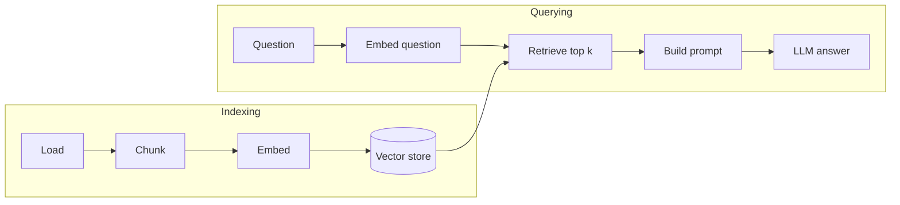
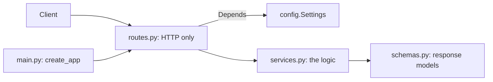

[!Draft|amber] [!Fast Track|blue] Build the structure of **RAG-FastTrack**, a production-style RAG project, in 8 steps. For each part you learn whether you need it, why, where it goes and how to check it works. Each step is tested and ends with a commit and push. The RAG code itself, the topic notebooks, the patterns and the mini projects come in later lectures: this one builds the base they plug into.

| Phase | Steps |
|---|---|
| Phase 1: Understand | 1 |
| Phase 2: Project | 2, 3, 4 |
| Phase 3: Build | 5, 6 |
| Phase 4: Deliver | 7, 8 |

## Step 1: What RAG is, and the project structure

[!Phase 1: Understand|blue]

Before writing code, learn what a RAG system does, how its pipeline flows, and which patterns exist. Then review the starting folder structure from the course image: what works, what breaks, and how we fix it.

::: objective
Explain RAG in two sentences, name the seven pipeline stages, and know why the project layout used in this lecture differs from the image.
:::

::: note Why
Every later step builds one stage of this pipeline. If you know the map, each file you create has an obvious place and purpose.
:::

### 1.1 What RAG is

A Large Language Model (LLM) only knows what it saw during training. **Retrieval-Augmented Generation (RAG)** gives it your documents at question time: find the passages that match the question, put them in the prompt, and ask the model to answer from them.

::: definition RAG
Retrieve relevant chunks from your own data, augment the prompt with them, then let the LLM generate an answer grounded in that context.
:::

::: cards
- **Fresh**: answers use today's documents, no retraining.
- **Grounded**: the answer can cite the chunks it used.
- **Controlled**: your documents stay in your own store; only the matching chunks go into the prompt. (With OpenAI embeddings the chunks are also sent once to be embedded; use a local embedding model to keep everything in-house.)
:::

### 1.2 The pipeline

RAG has two flows. **Indexing** runs when documents change. **Querying** runs for every question.



| Stage | What it does | Module in this project |
|---|---|---|
| Load | Read PDF, Markdown and text files | `ingestion/loader.py` |
| Chunk | Split text into overlapping pieces | `chunking/chunker.py` |
| Embed | Turn each chunk into a vector of numbers | `embeddings/embedder.py` |
| Store | Save vectors in a vector database | `vectordb/vector_store.py` |
| Retrieve | Find the chunks closest to the question | `retrieval/retriever.py` |
| Prompt | Put question and chunks into a template | `prompts/prompt_templates.py` |
| Generate | Ask the LLM for the answer | `llm/llm_client.py` |

In this lecture these modules stay empty: you create the files in step 3 and write the code in the RAG lectures.

### 1.3 RAG architectures

This lecture builds **naive RAG**: embed, retrieve the top k chunks, answer. Five architectures grow from it. Each one gets its own file in `src/rag_fasttrack/patterns/` (created empty in step 3) and its own lecture later.

| Architecture | Idea | Use when | File |
|---|---|---|---|
| Hybrid RAG | Dense vectors + BM25 keywords, merged with rank fusion (RRF) | Exact terms matter: codes, names, IDs. The best default | `hybrid.py` |
| GraphRAG | Extract entities, search a knowledge graph, summarise communities | Multi-hop questions where the answer is in relationships | `graph.py` |
| Agentic RAG | A planner agent picks tools (vector, web, SQL) and loops until the evidence is enough | Multi-step questions over several sources | `agentic.py` |
| Corrective RAG | A grader checks retrieved chunks; bad results trigger a rewrite and web search | Trust matters more than speed | `corrective.py` |
| Multimodal RAG | One index for text, images and tables (CLIP, ColPali), answered by a vision LLM | Real documents: scans, charts, tables | `multimodal.py` |

::: tip
Start with hybrid. Add graphs for relationships, agents for multi-step questions, grading for trust. Each one adds cost and latency, so measure before adding the next.
:::

*Architecture list based on "Top 5 RAG architectures for 2026" by Brij Kishore Pandey.*

### 1.4 The structure in the image: pros, cons and fixes

The course image proposes a flat project: `src/` with `ingestion`, `chunking`, `embeddings`, `vectordb`, `retrieval`, `prompts`, `llm`, `api` and `utils`, plus `main.py`, `config.yaml`, `.env`, `requirements.txt`, `logs/` and `tests/test_app.py`.

::: dodont
- One folder per pipeline stage: easy to find and teach
- Separate `prompts/` folder: prompts change often and deserve their own place
- `api/` kept apart from RAG logic
- `.env` for secrets
---
- `requirements.txt` in a uv project
- `src/` used as the package name, so imports read `from src.x import`
- `main.py` at the root duplicating the API entry point
- `config.yaml` and `.env` with nothing tying them together
- `logs/` inside the repo, one test file, a `utils/helpers.py` grab bag
:::

| Problem in the image | Fix in this lecture | Step |
|---|---|---|
| `requirements.txt` | `pyproject.toml` + `uv.lock`, with `dev` and `notebooks` dependency groups | 2 |
| `src/` is not a package | `src/rag_fasttrack/`: an installable package (src layout) | 2, 3 |
| No `data/`, `notebooks/`, `scripts/` | `data/raw`, `data/processed`, `data/indices`; numbered notebooks; a check script | 3, 4 |
| One `tests/test_app.py` | `tests/unit/` and `tests/integration/` | 3 |
| `config.yaml` + `.env` unconnected | One `Settings` class (pydantic-settings) reads `.env`; defaults live in code | 5 |
| `main.py` at the root | Entry point inside the package: the `rag-fasttrack` command | 5, 6 |
| `logs/` in the repo | Ignored by git; containers log to stdout | 2, 7 |
| `utils/helpers.py` | Small named modules, one job each (`paths.py`, `config.py`, `log.py`) | 3, 5 |
| No place for RAG architectures or mini projects | `patterns/` (shared code, one file per architecture), topic notebook folders, `mini-projects/` | 3 |
| No Docker, CI or `.env.example` | Added | 5, 7 |

### 1.5 What we build

| Part | Choice |
|---|---|
| Python | 3.12, managed with uv |
| RAG frameworks | LangChain and LlamaIndex: installed and checked here, used in later lectures |
| Vector databases | Chroma, FAISS and Qdrant: installed and checked here; one setting will choose between them |
| LLM | OpenAI (the key goes in `.env` when the RAG lectures need it) |
| Foundations | `Settings` from `.env`, project paths, logging, the `rag-fasttrack` command |
| API | A FastAPI skeleton: `/health`, `/ping`, `/info`, docs at `/docs` |
| Delivery | Docker, GitHub Actions CI, deploy to Amazon ECR + ECS Express Mode or App Runner |
| UI | A small HTML and JavaScript test page at `/ui` |
| Room to grow | `patterns/` for the five architectures, notebooks by topic, `mini-projects/` |

::: info No commit in this step
Step 1 is concepts only. The repository is created in step 2, and every step from there ends with a commit and push.
:::

### Checklist

- [ ] I can explain RAG in two sentences
- [ ] I can name the indexing and querying flows
- [ ] I know three problems in the image structure and their fixes

::: success Next
Step 2: create the GitHub repository and the uv project.
:::

## Step 2: GitHub repo and the uv project

[!Phase 2: Project|blue]

Create the `RAG-FastTrack` repository on GitHub first, clone it, then turn it into a production uv project with dependency groups.

::: objective
A GitHub repo with a uv package project: Python 3.12 pinned, `dev` and `notebooks` dependency groups, a lockfile, and a first commit pushed.
:::

::: note Why
Starting on GitHub means every file is tracked from day one. A package project (`--package`) installs your code into the environment, so notebooks, tests and the API import it the same way.
:::

::: prereq
Git, a GitHub account, and uv 0.11 or newer (`uv --version`). Optional: the GitHub CLI `gh`.
:::

### 2.1 Create and clone the repo

::: tabs
```bash title="GitHub CLI"
gh repo create RAG-FastTrack --public --clone
cd RAG-FastTrack
```
```bash title="GitHub website"
# github.com > New repository > name: RAG-FastTrack > no README, no .gitignore > Create
git clone https://github.com/<your-user>/RAG-FastTrack.git
cd RAG-FastTrack
```
:::

→ Create the repo empty: uv writes the README, and we write our own `.gitignore`.

### 2.2 Initialise the uv project

```bash title="Inside RAG-FastTrack"
uv python install 3.12
uv init --package --name rag-fasttrack --python 3.12 .
uv add --dev pytest ruff
uv add --group notebooks ipykernel jupyterlab nbconvert
```

→ `--package` creates `src/rag_fasttrack/` and a build backend; `--dev` and `--group` create the two dependency groups.

| Question | Dependency groups |
|---|---|
| Do we need them? | Yes. Some tools are only for us (tests, linting, Jupyter), not for the running app |
| Why? | The Docker image installs only what the app needs: smaller, faster, safer |
| Where? | `[dependency-groups]` in `pyproject.toml`: `dev` (pytest, ruff) and `notebooks` (Jupyter) |
| Check | `uv run pytest --version` and `uv run jupyter --version` both answer |

### 2.3 Finish pyproject.toml

Open `pyproject.toml` and make it match this file (description, Python range, default groups, ruff and pytest settings):

```toml title="pyproject.toml"
[project]
name = "rag-fasttrack"
version = "0.1.0"
description = "RAG Fast Track: a production-style Retrieval-Augmented Generation project (AI4Free)"
readme = "README.md"
requires-python = ">=3.12,<3.13"
dependencies = []

[project.scripts]
rag-fasttrack = "rag_fasttrack:main"

[dependency-groups]
dev = [
    "pytest>=8.3",
    "ruff>=0.8",
]
notebooks = [
    "ipykernel>=6.29",
    "jupyterlab>=4.3",
    "nbconvert>=7.16",
]

[tool.uv]
default-groups = ["dev", "notebooks"]

[build-system]
requires = ["uv_build>=0.11.32,<0.12.0"]
build-backend = "uv_build"

[tool.ruff]
line-length = 110
target-version = "py312"

[tool.pytest.ini_options]
testpaths = ["tests"]
```

→ `requires-python` is pinned to 3.12 so every machine and the Docker image agree.
→ `default-groups` makes a plain `uv sync` install both groups; Docker uses `--no-default-groups` to skip them.

### 2.4 .gitignore and README

```gitignore title=".gitignore"
# Python
__pycache__/
*.py[cod]
.venv/
.pytest_cache/
.ruff_cache/
*.egg-info/
dist/
build/

# Secrets: never commit real keys (.env.example is committed instead)
.env

# Notebooks
.ipynb_checkpoints/

# Logs (containers log to stdout)
logs/
*.log

# Data: keep the folders, not the generated files
data/processed/*
data/indices/*
!data/processed/.gitkeep
!data/indices/.gitkeep

# OS / editors
.DS_Store
.vscode/
.idea/
```

→ `data/processed` and `data/indices` hold generated files, so only their `.gitkeep` files are committed.

Replace `README.md` with a short description and the two commands `uv sync` and `uv run rag-fasttrack`. The final README is written in step 8.

### 2.5 Verify

```terminal
$ uv sync
$ uv run rag-fasttrack
Hello from rag-fasttrack!
$ uv run python --version
Python 3.12.x
```

::: mistake
Running `uv init` without `--package` creates a flat project: there is no `src/rag_fasttrack/` and imports from notebooks fail later.
:::

### 2.6 Commit and push

```bash title="Commit"
git add -A
git commit -m "Step 2: uv project with dev and notebooks dependency groups"
git tag step-2
git branch -M main      # some Git setups name the first branch master
git push -u origin main --tags
```

```tree
RAG-FastTrack/
├── .gitignore
├── .python-version
├── README.md
├── pyproject.toml
├── uv.lock
└── src/
    └── rag_fasttrack/
        └── __init__.py
```

#### Details

| Item | Value |
|---|---|
| Build backend | `uv_build` |
| Groups | `dev`: pytest, ruff · `notebooks`: ipykernel, jupyterlab, nbconvert |
| Commit | `uv.lock` yes · `.venv/` and `.env` never |

### Checklist

- [ ] Repo `RAG-FastTrack` exists on GitHub
- [ ] `uv run rag-fasttrack` prints the hello message
- [ ] Commit `step-2` pushed

::: success Next
Step 3: the folder structure, data folders and a runnable notebook.
:::

## Step 3: Folder structure, data and notebooks

[!Phase 2: Project|blue]

Create the improved structure: one package folder per pipeline stage, the three data folders, test folders, and a notebook that runs on the project's own environment.

::: objective
The full skeleton exists, the modules are empty placeholders, the notebook kernel points to `.venv`, and a structure test passes.
:::

::: note Why
The skeleton is the map from step 1 turned into folders. Empty modules are fine: each lecture or mini project fills the ones it needs.
:::

### 3.1 Create the folders and empty modules

Open **Git Bash** in the project folder. `mkdir -p` creates a folder (and any missing parent folders). `touch` creates an empty file. A folder must exist before `touch` can put a file in it. `&&` runs the second command only if the first one worked.

| Question | Answer |
|---|---|
| Do we need empty folders and files now? | Yes. Everyone sees the full map of the project from day one, and each later lecture knows exactly where its code goes |
| Why `.gitkeep`? | Git does not save empty folders. An empty `.gitkeep` file keeps the folder in the repo |
| Why `__init__.py`? | It turns a folder into a Python package, so `import rag_fasttrack.ingestion` works |
| Check | The structure test in 3.5 imports every package |

**1. Data, tests, notebooks and mini projects**

```bash title="Run from the project root"
# Data: your files, and two folders for generated files
mkdir -p data/raw data/processed data/indices
touch data/processed/.gitkeep data/indices/.gitkeep

# Tests: fast unit tests and API integration tests
mkdir -p tests/unit tests/integration
touch tests/__init__.py tests/unit/__init__.py tests/integration/__init__.py

# Notebooks: one folder per topic, filled in later lectures
mkdir -p notebooks/01-rag-basics   && touch notebooks/01-rag-basics/.gitkeep
mkdir -p notebooks/02-prompts      && touch notebooks/02-prompts/.gitkeep
mkdir -p notebooks/03-langchain    && touch notebooks/03-langchain/.gitkeep
mkdir -p notebooks/04-llamaindex   && touch notebooks/04-llamaindex/.gitkeep
mkdir -p notebooks/05-langgraph    && touch notebooks/05-langgraph/.gitkeep
mkdir -p notebooks/06-rag-patterns && touch notebooks/06-rag-patterns/.gitkeep

# Mini projects: one folder per project, later
mkdir -p mini-projects
touch mini-projects/.gitkeep
```

**2. The package: one folder per pipeline stage, plus patterns and the API**

```bash title="Create the package modules"
cd src/rag_fasttrack

mkdir -p ingestion chunking embeddings vectordb
mkdir -p retrieval prompts llm patterns api

touch ingestion/__init__.py   ingestion/loader.py
touch chunking/__init__.py    chunking/chunker.py
touch embeddings/__init__.py  embeddings/embedder.py
touch vectordb/__init__.py    vectordb/vector_store.py
touch retrieval/__init__.py   retrieval/retriever.py
touch prompts/__init__.py     prompts/prompt_templates.py
touch llm/__init__.py         llm/llm_client.py
touch patterns/__init__.py    patterns/hybrid.py
touch patterns/graph.py       patterns/agentic.py
touch patterns/corrective.py  patterns/multimodal.py
touch api/__init__.py

cd ../..
```

| Folder | Why we need it | Filled in |
|---|---|---|
| `ingestion/` … `llm/` | One package per pipeline stage (the table in step 1.2): easy to find, easy to teach | RAG lectures |
| `patterns/` | One file per RAG architecture; each imports the shared stages instead of copying them | Pattern lectures |
| `api/` | The web layer, kept apart from the RAG logic | Step 6 |
| `notebooks/<topic>/` | Learning notebooks, grouped by topic | Topic lectures |
| `mini-projects/` | One folder per mini project, using the shared code in `src/` | Mini projects |

::: details Advanced: the same structure with one script
Loops save typing once you are comfortable with Bash. This creates exactly the same files.

```bash title="Advanced, optional"
for topic in 01-rag-basics 02-prompts 03-langchain 04-llamaindex 05-langgraph 06-rag-patterns; do
  mkdir -p "notebooks/$topic" && touch "notebooks/$topic/.gitkeep"
done

cd src/rag_fasttrack
for pair in ingestion:loader chunking:chunker embeddings:embedder vectordb:vector_store \
            retrieval:retriever prompts:prompt_templates llm:llm_client \
            patterns:hybrid patterns:graph patterns:agentic patterns:corrective patterns:multimodal; do
  pkg=${pair%%:*}; mod=${pair##*:}            # "ingestion:loader" -> pkg=ingestion, mod=loader
  mkdir -p "$pkg" && touch "$pkg/__init__.py" "$pkg/$mod.py"
done
mkdir -p api && touch api/__init__.py
cd ../..
```
:::

### 3.2 One place for paths

```python title="src/rag_fasttrack/paths.py"
"""Project paths. Everything is relative to the project root, so notebooks, tests, the API and Docker agree."""
from pathlib import Path

ROOT = Path(__file__).resolve().parents[2]      # src/rag_fasttrack/paths.py -> project root
DATA_DIR = ROOT / "data"
RAW_DIR = DATA_DIR / "raw"                      # your source files
PROCESSED_DIR = DATA_DIR / "processed"          # cleaned chunks (generated)
INDICES_DIR = DATA_DIR / "indices"              # vector indexes (generated)
NOTEBOOKS_DIR = ROOT / "notebooks"
```

→ Notebooks, tests, the API and Docker all start from different folders. Paths built from `ROOT` work in all of them.

| Question | Answer |
|---|---|
| Do we need it? | Yes. Every part of the project reads or writes files in `data/` |
| Why not write `"data/raw"` directly? | A relative path depends on the folder you run from: it works in one place and breaks in a notebook, a test or Docker |
| Where? | `src/rag_fasttrack/paths.py`, one small module everyone imports |
| Check | The structure test in 3.5 checks the data folders exist |

### 3.3 Sample documents

Put three small Markdown files in `data/raw/`. They give every later step something to load, search and test.

```markdown title="data/raw/01-what-is-rag.md"
# What is RAG?

Retrieval-Augmented Generation (RAG) lets a language model answer questions using your own documents.
Instead of relying only on what the model learned during training, a RAG system first retrieves the most
relevant passages from a knowledge base, then gives them to the model as context for the answer.

A RAG pipeline has two phases. In the indexing phase, documents are loaded, split into chunks, turned into
embeddings and stored in a vector database. In the query phase, the question is embedded, similar chunks are
retrieved, a prompt is built from the question and the chunks, and the language model generates the answer.

RAG reduces hallucinations, keeps answers up to date without retraining, and lets the system cite its sources.
```

```markdown title="data/raw/02-vector-databases.md"
# Vector databases

A vector database stores embeddings and finds the vectors closest to a query vector.
Chroma is an open-source vector database that is easy to run locally and saves its data to a folder.
FAISS is a library from Meta for fast similarity search; it keeps the index in memory and can save it to a file.
Qdrant is a vector search engine written in Rust; it can run as a server, in the cloud, or in local mode from Python.

Similarity is usually measured with cosine similarity or dot product. Good chunk size and overlap matter as much
as the database: chunks that are too large dilute the meaning, chunks that are too small lose context.
```

```markdown title="data/raw/03-fastapi-and-uv.md"
# FastAPI and uv

FastAPI is a modern Python web framework for building APIs. It uses type hints and Pydantic models to validate
requests and responses, and it generates interactive documentation at /docs automatically.

uv is a fast Python package and project manager written in Rust. It replaces pip, pip-tools and virtualenv:
uv init creates a project, uv add installs a dependency and records it in pyproject.toml, uv sync installs
everything from the lock file, and uv run runs a command inside the project environment.
Dependency groups such as dev and notebooks keep tools out of the production install.
```

### 3.4 A notebook kernel for the project

```bash title="Register the kernel once"
uv run python -m ipykernel install --user --name rag-fasttrack --display-name "RAG-FastTrack (uv)"
uv run jupyter lab
```

→ Pick **RAG-FastTrack (uv)** in Jupyter or VS Code. The notebook then uses `.venv` and can import `rag_fasttrack`.

Create `notebooks/00_setup_check.ipynb` with these cells (each `# %%` starts a new cell):

```python title="notebooks/00_setup_check.ipynb"
# %% [markdown]
# # 00 Setup check
#
# Run this notebook with the **RAG-FastTrack (uv)** kernel. It proves the notebook uses the project's `.venv`
# and can import the `rag_fasttrack` package and find the data folders.

# %%
import sys

import rag_fasttrack
from rag_fasttrack import paths

print("Python:", sys.version.split()[0])
print("Interpreter:", sys.executable)
print("Package:", rag_fasttrack.__file__)

# %%
for folder in (paths.RAW_DIR, paths.PROCESSED_DIR, paths.INDICES_DIR):
    print(f"{folder.relative_to(paths.ROOT)}: exists={folder.is_dir()}")

# %%
docs = sorted(paths.RAW_DIR.glob("*.md"))
print(len(docs), "documents in data/raw")
for d in docs:
    print(" -", d.name)

# %%
print(docs[0].read_text(encoding="utf-8")[:300])
```

### 3.5 Structure test

```python title="tests/unit/test_structure.py"
"""Step 3: the project structure exists and the package imports."""
import importlib

from rag_fasttrack import paths

PACKAGES = ["ingestion", "chunking", "embeddings", "vectordb", "retrieval", "prompts", "llm", "api", "patterns"]


def test_packages_import():
    for name in PACKAGES:
        importlib.import_module(f"rag_fasttrack.{name}")


def test_data_folders_exist():
    for folder in (paths.RAW_DIR, paths.PROCESSED_DIR, paths.INDICES_DIR):
        assert folder.is_dir(), folder


def test_sample_documents_present():
    assert len(list(paths.RAW_DIR.glob("*.md"))) >= 3
```

### 3.6 Verify

```terminal
$ uv run pytest -q
3 passed
```

In Jupyter, open `notebooks/00_setup_check.ipynb`, pick the **RAG-FastTrack (uv)** kernel and choose **Run All**: every cell runs without an error and lists the three data folders and three documents.

::: mistake
Running the notebook on the system Python kernel: `import rag_fasttrack` fails with ModuleNotFoundError. Switch the kernel to **RAG-FastTrack (uv)**.
:::

### 3.7 Commit and push

```bash title="Commit"
git add -A
git commit -m "Step 3: folder structure, patterns package, topic notebook folders, mini-projects, data folders"
git tag step-3
git push && git push --tags
```

```tree
RAG-FastTrack/
├── data/
│   ├── raw/          # 3 sample .md files
│   ├── processed/    # generated chunks (not in git)
│   └── indices/      # generated vector indexes (not in git)
├── mini-projects/    # one folder per mini project (later)
├── notebooks/
│   ├── 00_setup_check.ipynb
│   ├── 01-rag-basics/
│   ├── 02-prompts/
│   ├── 03-langchain/
│   ├── 04-llamaindex/
│   ├── 05-langgraph/
│   └── 06-rag-patterns/
├── src/rag_fasttrack/
│   ├── __init__.py
│   ├── paths.py
│   ├── ingestion/    loader.py
│   ├── chunking/     chunker.py
│   ├── embeddings/   embedder.py
│   ├── vectordb/     vector_store.py
│   ├── retrieval/    retriever.py
│   ├── prompts/      prompt_templates.py
│   ├── llm/          llm_client.py
│   ├── patterns/     hybrid.py · graph.py · agentic.py · corrective.py · multimodal.py
│   └── api/          (empty, step 6)
├── tests/
│   ├── unit/test_structure.py
│   └── integration/
├── pyproject.toml
└── uv.lock
```

### Checklist

- [ ] Nine packages import, including `patterns`
- [ ] `data/raw` has three sample files
- [ ] The notebook runs on the **RAG-FastTrack (uv)** kernel
- [ ] Commit `step-3` pushed

::: success Next
Step 4: add the Python, RAG and LLM libraries and test that they import.
:::

## Step 4: Add and test the libraries

[!Phase 2: Project|blue]

Add every library the project needs in one go, then prove each one imports with a check script and a test.

::: objective
20 libraries installed and locked; `scripts/check_libs.py` reports "20 of 20 libraries import correctly".
:::

::: note Why
Large AI stacks often break at install time (version conflicts, missing wheels). Checking imports now means later errors come from your code, not the environment.
:::

### 4.1 Add the libraries

```bash title="Runtime libraries"
uv add fastapi "uvicorn[standard]" pydantic-settings numpy pypdf openai \
  langchain-core langchain-text-splitters langchain-openai langchain-chroma langchain-qdrant \
  llama-index-core llama-index-embeddings-openai llama-index-llms-openai \
  llama-index-vector-stores-chroma llama-index-vector-stores-faiss llama-index-vector-stores-qdrant \
  chromadb faiss-cpu qdrant-client
```

→ One command on purpose: uv then picks versions that work together. Added one by one, `openai` is installed at its newest version first, and the LlamaIndex packages that need an older `openai` can no longer be added.

| Group | Libraries | Purpose |
|---|---|---|
| API | fastapi, uvicorn, pydantic-settings | Web API and settings |
| Python basics | numpy, pypdf | Vectors, PDF reading |
| LLM | openai | OpenAI client |
| LangChain | core, text-splitters, openai, chroma, qdrant | Framework 1 |
| LlamaIndex | core, OpenAI embeddings and LLM, Chroma, FAISS, Qdrant stores | Framework 2 |
| Vector databases | chromadb, faiss-cpu, qdrant-client | The three stores |

::: warning Not langchain-community
`langchain-community` is being sunset. We use the dedicated packages (`langchain-chroma`, `langchain-qdrant`) and call FAISS directly.
:::

### 4.2 Import check script

```python title="scripts/check_libs.py"
"""Step 4: import every library the project uses and print its version.

Run: uv run python scripts/check_libs.py
"""
import importlib
import sys
from importlib.metadata import PackageNotFoundError, version

# (import name, package name on PyPI, what it is for)
LIBS = [
    ("fastapi", "fastapi", "API framework"),
    ("uvicorn", "uvicorn", "ASGI server that runs the API"),
    ("pydantic_settings", "pydantic-settings", "Settings from .env"),
    ("numpy", "numpy", "Vectors and math"),
    ("pypdf", "pypdf", "Read PDF files"),
    ("openai", "openai", "OpenAI API client"),
    ("langchain_core", "langchain-core", "LangChain core"),
    ("langchain_text_splitters", "langchain-text-splitters", "LangChain text splitters"),
    ("langchain_openai", "langchain-openai", "LangChain + OpenAI"),
    ("langchain_chroma", "langchain-chroma", "LangChain + Chroma"),
    ("langchain_qdrant", "langchain-qdrant", "LangChain + Qdrant"),
    ("llama_index.core", "llama-index-core", "LlamaIndex core"),
    ("llama_index.embeddings.openai", "llama-index-embeddings-openai", "LlamaIndex + OpenAI embeddings"),
    ("llama_index.llms.openai", "llama-index-llms-openai", "LlamaIndex + OpenAI LLM"),
    ("llama_index.vector_stores.chroma", "llama-index-vector-stores-chroma", "LlamaIndex + Chroma"),
    ("llama_index.vector_stores.faiss", "llama-index-vector-stores-faiss", "LlamaIndex + FAISS"),
    ("llama_index.vector_stores.qdrant", "llama-index-vector-stores-qdrant", "LlamaIndex + Qdrant"),
    ("chromadb", "chromadb", "Chroma vector database"),
    ("faiss", "faiss-cpu", "FAISS similarity search (used directly; langchain-community is sunset)"),
    ("qdrant_client", "qdrant-client", "Qdrant vector database client"),
]


def main() -> int:
    print(f"Python {sys.version.split()[0]}\n")
    failed = 0
    for module, package, purpose in LIBS:
        try:
            importlib.import_module(module)
            try:
                ver = version(package)
            except PackageNotFoundError:
                ver = "?"
            print(f"  OK    {package:<36} {ver:<10} {purpose}")
        except Exception as exc:  # noqa: BLE001 - report every failure, keep going
            failed += 1
            print(f"  FAIL  {package:<36} {type(exc).__name__}: {exc}")
    print(f"\n{len(LIBS) - failed} of {len(LIBS)} libraries import correctly.")
    return 1 if failed else 0


if __name__ == "__main__":
    sys.exit(main())
```

→ Imports each library, prints its version, and returns exit code 1 if anything fails, so CI can use it.

| Question | Answer |
|---|---|
| Do we need an import check? | Yes. Big AI libraries can install fine and still fail on import (a missing system library, a version clash) |
| Why now? | So later errors come from your code, not the environment |
| Where? | `scripts/check_libs.py` for people; `tests/unit/test_libraries.py` runs it automatically |
| Check | `uv run python scripts/check_libs.py` ends with "20 of 20" |

```python title="tests/unit/test_libraries.py"
"""Step 4: every project library imports."""
import runpy
from pathlib import Path

SCRIPT = Path(__file__).resolve().parents[2] / "scripts" / "check_libs.py"


def test_all_libraries_import():
    check = runpy.run_path(str(SCRIPT))
    assert check["main"]() == 0
```

### 4.3 Verify

```terminal
$ uv run python scripts/check_libs.py
Python 3.12.x

  OK    fastapi                              0.1xx      API framework
  ...
  OK    qdrant-client                        1.1x       Qdrant vector database client

20 of 20 libraries import correctly.
$ uv run pytest -q
4 passed
```

::: mistake
Installing with `pip install` inside `.venv`: the package is not written to `pyproject.toml` or `uv.lock`, so the next `uv sync` removes it. Always use `uv add`.
:::

### 4.4 Commit and push

```bash title="Commit"
git add -A
git commit -m "Step 4: add Python, RAG, LLM and API libraries with an import check"
git tag step-4
git push && git push --tags
```

### Checklist

- [ ] 20 of 20 libraries import
- [ ] `pyproject.toml` and `uv.lock` updated and committed
- [ ] Commit `step-4` pushed

::: success Next
Step 5: the foundations: settings, logging and the entry point.
:::

## Step 5: Foundations: settings, logging and the entry point

[!Phase 3: Build|green]

Before any feature, every project needs the same few foundations: one place for settings, one place for paths, one way to log, one command to start it, and a quick way to prove they all work. This step builds each one, and for each one answers: do we need it, why, and where does it go?

::: objective
`uv run rag-fasttrack` reads the settings, writes a log line and prints what is configured. 10 tests and the setup notebook pass.
:::

::: note Why
Every later lecture (RAG modules, API, patterns, mini projects) uses these foundations. Built once, in the right place, nobody copies settings or logging code again.
:::

### 5.1 Settings: do we need a class, and which kind?

| Question | Answer |
|---|---|
| Do we need it? | Yes. Every part of the project needs values that change per machine: model names, chunk size, API keys |
| Why a class? | Without one, values end up hard-coded or read with `os.getenv(...)` in many files |
| Where? | `src/rag_fasttrack/config.py`, directly in the package, not inside `api/`: the API, notebooks, scripts and tests all import it |
| Check | `tests/unit/test_config.py`, and `uv run rag-fasttrack` prints the values (5.7) |

::: compare
`os.getenv("CHUNK_SIZE")` in five files: always a string, no default, a typo returns `None` silently, and the key can end up in a log.
---
One `Settings` class: typed (`chunk_size: int = 500`), checked at start-up, defaults in one place, values from `.env`, and the key hidden.
:::

**Option 1: a plain dataclass.** The idea in a few lines, with Python only:

```python title="Example only: settings as a dataclass"
import os
from dataclasses import dataclass


@dataclass(frozen=True)          # frozen: values can't be changed by mistake later
class Settings:
    app_name: str = "RAG-FastTrack"
    chunk_size: int = 500
    openai_api_key: str | None = None


settings = Settings(
    chunk_size=int(os.getenv("CHUNK_SIZE", "500")),   # you convert every value yourself
    openai_api_key=os.getenv("OPENAI_API_KEY"),        # .env is not read: needs extra code
)
print(settings)   # prints the key in plain text
```

It works, but every reading, converting and checking step is yours to write, and `print(settings)` shows the key.

**Option 2: pydantic `BaseSettings`.** Same idea, the boring parts done for you:

| | `@dataclass` | `BaseSettings` |
|---|---|---|
| Reads environment variables | You write `os.getenv` per field | Automatic, by field name |
| Reads `.env` | Extra code | Automatic |
| Converts `"500"` to `500` | You write `int(...)` | Automatic, from the type |
| Rejects `VECTOR_STORE=chorma` | You write the check | Automatic, with `Literal[...]` |
| Hides the API key | No | `SecretStr` prints `**********` |
| Extra install | None | `pydantic-settings` (step 4) |

We use Option 2:

```python title="src/rag_fasttrack/config.py"
"""Settings for the whole project, read from environment variables and the .env file.

One place for configuration: the API, notebooks, tests and Docker all call get_settings().
Secrets (OPENAI_API_KEY) live only in .env, which git ignores; .env.example shows the names.
"""
from functools import lru_cache
from typing import Literal

from pydantic import SecretStr
from pydantic_settings import BaseSettings, SettingsConfigDict

from rag_fasttrack.paths import ROOT


class Settings(BaseSettings):
    model_config = SettingsConfigDict(env_file=ROOT / ".env", env_file_encoding="utf-8", extra="ignore")

    # App
    app_name: str = "RAG-FastTrack"
    app_version: str = "0.1.0"
    environment: Literal["local", "dev", "prod"] = "local"
    log_level: str = "INFO"

    # RAG choices (switch without code changes)
    framework: Literal["langchain", "llamaindex"] = "langchain"
    vector_store: Literal["chroma", "faiss", "qdrant"] = "chroma"
    chunk_size: int = 500
    chunk_overlap: int = 50
    top_k: int = 3

    # OpenAI (optional: without a key the project runs in offline mode)
    openai_api_key: SecretStr | None = None
    llm_model: str = "gpt-4o-mini"
    embedding_model: str = "text-embedding-3-small"

    @property
    def offline(self) -> bool:
        """True when no OpenAI key is set: embeddings and answers use the free offline fallback."""
        return not (self.openai_api_key and self.openai_api_key.get_secret_value().strip())


@lru_cache
def get_settings() -> Settings:
    return Settings()
```

→ `BaseSettings` reads each field from an environment variable of the same name (`CHUNK_SIZE` → `chunk_size`), then from `.env`, then uses the default.

→ `Literal["chroma", "faiss", "qdrant"]` rejects a typo such as `VECTOR_STORE=chorma` at start-up, with a clear error.

→ `@lru_cache` builds the settings once; every `get_settings()` call returns the same object.

`.env.example` lists every setting. It is committed; your real `.env` is not:

```dotenv title=".env.example"
# Copy to .env and fill in. .env is ignored by git; never commit real keys.
# Keep comments on their own lines: docker run --env-file reads everything after "=" as the value.

# App
APP_NAME=RAG-FastTrack
# ENVIRONMENT: local | dev | prod
ENVIRONMENT=local
LOG_LEVEL=INFO

# RAG choices
# FRAMEWORK: langchain | llamaindex
FRAMEWORK=langchain
# VECTOR_STORE: chroma | faiss | qdrant
VECTOR_STORE=chroma
CHUNK_SIZE=500
CHUNK_OVERLAP=50
TOP_K=3

# OpenAI (optional). Leave empty to run offline with the free fallback.
OPENAI_API_KEY=
LLM_MODEL=gpt-4o-mini
EMBEDDING_MODEL=text-embedding-3-small
```

```bash title="Create your local .env"
cp .env.example .env
```

::: danger
Never commit `.env`. It will hold real API keys. `.gitignore` from step 2 already excludes it.
:::

### 5.2 Paths: already in place

`paths.py` from step 3 answers "where are the files?". It is separate from the settings because paths are worked out from where the code lives, not configured per machine. Use it instead of writing `"data/raw"` by hand: a hand-written relative path breaks as soon as the code runs from another folder (a notebook, a test, Docker).

### 5.3 Do we need logging?

Yes. `print` is fine for a quick look, but it has no time, no level and no source, and you can't switch it off in production.

| | `print` | `logging` |
|---|---|---|
| Time and source | No | Yes: `2026-10-09 12:00:01 INFO rag_fasttrack.ingestion: ...` |
| Levels (DEBUG, INFO, WARNING, ERROR) | No | Yes, filtered by `LOG_LEVEL` in `.env` |
| Works in Docker and AWS logs | Mixed with everything else | Yes |

| Question | Answer |
|---|---|
| Do we need it? | Yes, from the first line of real code |
| Why? | Time, level and source on every line; quiet or detailed with one setting |
| Where? | `src/rag_fasttrack/log.py`: `setup_logging()` once in each entry point, `get_logger("name")` in every other file |
| Check | `test_logger_names_and_output` (5.6), and the INFO line when you run `uv run rag-fasttrack` |

```python title="src/rag_fasttrack/log.py"
"""Logging for the whole project: call setup_logging() once at start, then get_logger() in any file."""
import logging

FORMAT = "%(asctime)s %(levelname)s %(name)s: %(message)s"


def setup_logging(level: str = "INFO") -> None:
    """Configure the root logger once. Calling it again does nothing, so every entry point can call it."""
    logging.basicConfig(level=level.upper(), format=FORMAT)


def get_logger(name: str) -> logging.Logger:
    """A logger named rag_fasttrack.<name>, so every log line shows which part of the project wrote it."""
    return logging.getLogger(f"rag_fasttrack.{name}")
```

How any file in the project will use it:

```python title="Example: inside a future module"
from rag_fasttrack.log import get_logger

log = get_logger("ingestion")
log.info("Loaded %d files from %s", 3, "data/raw")
```

### 5.4 How imports work in a src layout

`uv sync` installs `rag_fasttrack` into `.venv` as a package (an editable install: your changes apply at once). So the same import works from every place:

| From | Import |
|---|---|
| A module in `src/rag_fasttrack/` | `from rag_fasttrack.config import get_settings` |
| A test in `tests/` | `from rag_fasttrack.config import get_settings` |
| A notebook (RAG-FastTrack kernel) | `from rag_fasttrack.config import get_settings` |
| A script in `scripts/` | `from rag_fasttrack.config import get_settings` |

::: dodont
- Absolute imports starting with `rag_fasttrack.`
- Run code with `uv run ...` so the project's `.venv` is used
---
- `from src.rag_fasttrack import ...`
- `sys.path.append(...)` to make an import work
:::

### 5.5 The entry point

| Question | Answer |
|---|---|
| Do we need it? | Yes. One command that everyone (and Docker) uses to start the project |
| Why not `python main.py`? | It depends on the folder you are in and the Python you call; `uv run rag-fasttrack` always uses the project's `.venv` |
| Where? | `main()` in `src/rag_fasttrack/__init__.py`, named in `pyproject.toml` |
| Check | `test_entry_point_prints_settings` (5.6), and running the command (5.7) |

Step 2 declared the command in `pyproject.toml`:

```toml title="pyproject.toml (from step 2)"
[project.scripts]
rag-fasttrack = "rag_fasttrack:main"
```

→ `uv run rag-fasttrack` calls the `main()` function in `src/rag_fasttrack/__init__.py`. Make it load the settings and set up logging:

```python title="src/rag_fasttrack/__init__.py"
"""RAG-FastTrack: a production-style RAG starter project (AI4Free RAG Fast Track lecture)."""


def main() -> None:
    """Entry point for `uv run rag-fasttrack` (declared in pyproject.toml under [project.scripts]).

    Step 5: load the settings, set up logging and show what is configured.
    Step 6 changes it to start the API.
    """
    from rag_fasttrack.config import get_settings
    from rag_fasttrack.log import get_logger, setup_logging

    settings = get_settings()
    setup_logging(settings.log_level)
    get_logger("main").info("started")
    print(f"{settings.app_name} {settings.app_version} | environment: {settings.environment} "
          f"| vector store: {settings.vector_store} | offline: {settings.offline}")
```

→ The imports sit inside `main()` so that `import rag_fasttrack` stays fast; only running the command loads the settings.

### 5.6 Check that everything works

| Question | Answer |
|---|---|
| Do we need checks this early? | Yes. A check written now runs on every change from now on, for free |
| Why two kinds? | Tests prove the Python code; the notebook runner proves the notebooks still run after library updates |
| Where? | `tests/unit/` for tests, `scripts/run_notebooks.py` for notebooks |
| Check | `uv run pytest -q` and `uv run python scripts/run_notebooks.py` (5.7) |

```python title="tests/unit/test_config.py"
"""Step 5: settings load from .env-style values and keep the key secret."""
from rag_fasttrack.config import Settings


def test_defaults_are_offline():
    s = Settings(_env_file=None)
    assert s.offline is True
    assert s.framework == "langchain"


def test_key_turns_offline_off_and_stays_hidden():
    s = Settings(_env_file=None, openai_api_key="sk-test-123")
    assert s.offline is False
    assert "sk-test-123" not in repr(s)


def test_env_example_parses(tmp_path):
    from rag_fasttrack.paths import ROOT

    env = tmp_path / ".env"
    env.write_text((ROOT / ".env.example").read_text())
    s = Settings(_env_file=env)
    assert s.environment == "local" and s.vector_store == "chroma" and s.offline
```

```python title="tests/unit/test_foundations.py"
"""Step 5: the foundations work together: imports, paths, logging and the entry point."""
import logging

from rag_fasttrack import main, paths
from rag_fasttrack.log import get_logger, setup_logging


def test_paths_point_into_the_project():
    assert (paths.ROOT / "pyproject.toml").is_file()
    assert paths.RAW_DIR == paths.ROOT / "data" / "raw"


def test_logger_names_and_output(caplog):
    setup_logging("INFO")
    log = get_logger("test")
    assert log.name == "rag_fasttrack.test"
    with caplog.at_level(logging.INFO):
        log.info("hello")
    assert "hello" in caplog.text


def test_entry_point_prints_settings(capsys):
    main()
    assert "RAG-FastTrack" in capsys.readouterr().out
```

The notebook runner reads keys from `.env`, so add `python-dotenv` first:

```bash title="The notebook runner reads .env with python-dotenv"
uv add python-dotenv
```

```python title="scripts/run_notebooks.py"
"""Run every notebook top to bottom and report which ones pass.

Run:  uv run python scripts/run_notebooks.py               all notebooks
      uv run python scripts/run_notebooks.py notebooks/02-prompts   one folder

Keys come from the project's .env file (one file for all notebooks) or the shell.
A notebook that needs an API key is skipped when the key is missing. Mark it in the notebook metadata:
  "metadata": {"requires": ["OPENAI_API_KEY"]}
Notebooks are not changed: outputs are not saved.
"""
import os
import sys
import time
from pathlib import Path

import nbformat
from dotenv import load_dotenv
from nbconvert.preprocessors import CellExecutionError, ExecutePreprocessor

ROOT = Path(__file__).resolve().parents[1]
load_dotenv(ROOT / ".env")      # keys for the check below and for every notebook kernel (inherits the environment)


def find(target: Path) -> list[Path]:
    if target.is_file():
        return [target]
    return sorted(p for p in target.rglob("*.ipynb") if ".ipynb_checkpoints" not in p.parts)


def main() -> int:
    target = Path(sys.argv[1]) if len(sys.argv) > 1 else ROOT / "notebooks"
    if not target.exists():
        print(f"Not found: {target}")
        return 1
    passed = failed = skipped = 0
    for path in find(target.resolve()):
        name = path.relative_to(ROOT) if path.is_relative_to(ROOT) else path
        nb = nbformat.read(path, as_version=4)
        missing = [k for k in nb.metadata.get("requires", []) if not os.getenv(k)]
        if missing:
            skipped += 1
            print(f"  SKIP  {name}  (needs {', '.join(missing)})")
            continue
        start = time.time()
        try:
            ExecutePreprocessor(timeout=600, kernel_name="python3").preprocess(nb, {"metadata": {"path": str(path.parent)}})
            passed += 1
            print(f"  OK    {name}  ({time.time() - start:.0f}s)")
        except CellExecutionError as exc:
            failed += 1
            print(f"  FAIL  {name}  {str(exc).strip().splitlines()[-1]}")
        except Exception as exc:  # noqa: BLE001 - timeout or dead kernel: report it and run the next notebook
            failed += 1
            print(f"  FAIL  {name}  {type(exc).__name__}: {exc}")
    print(f"\n{passed} passed, {failed} failed, {skipped} skipped")
    return 1 if failed else 0


if __name__ == "__main__":
    sys.exit(main())
```

→ It runs every notebook from top to bottom without saving outputs, and reports OK, FAIL or SKIP. A notebook that needs a key declares `"requires": ["OPENAI_API_KEY"]` in its metadata and is skipped while the key is missing. CI runs it on every push (step 7).

### 5.7 Verify

```terminal
$ uv run pytest -q
10 passed
$ uv run rag-fasttrack
2026-10-09 12:00:01,123 INFO rag_fasttrack.main: started
RAG-FastTrack 0.1.0 | environment: local | vector store: chroma | offline: True
$ uv run python scripts/run_notebooks.py
  OK    notebooks/00_setup_check.ipynb  (1s)

1 passed, 0 failed, 0 skipped
```

Change `LOG_LEVEL=WARNING` in `.env` and run `uv run rag-fasttrack` again: the INFO line disappears. Set it back to `INFO`.

::: mistake
A typo in `.env`, such as `VECTOR_STORE=chorma`: the command stops with a validation error that names the field. Read the last lines of the error, fix `.env`, run again.
:::

### 5.8 Commit and push

```bash title="Commit"
git add -A
git commit -m "Step 5: foundations: settings, logging, entry point, smoke tests, notebook runner"
git tag step-5
git push && git push --tags
```

#### Details

| File | Its one job |
|---|---|
| `config.py` | All settings, typed, from `.env` |
| `paths.py` | Where the project's folders are |
| `log.py` | Set up logging once; a named logger for every file |
| `__init__.py` → `main()` | The `rag-fasttrack` command |
| `tests/unit/` | Prove the foundations work |
| `scripts/run_notebooks.py` | Prove the notebooks work |

### Checklist

- [ ] `.env` created from `.env.example`, and not committed
- [ ] `uv run rag-fasttrack` prints the settings
- [ ] 10 tests pass and the notebook runner reports 1 passed
- [ ] Commit `step-5` pushed

::: success Next
Step 6: put a FastAPI skeleton on top of these foundations.
:::

## Step 6: FastAPI skeleton

[!Phase 3: Build|green]

Add a small FastAPI app with three service endpoints, `/health`, `/ping` and `/info`, and use it to learn the shape every API in this course follows: schemas, services, routes and an app factory.

::: objective
`uv run rag-fasttrack` serves the API at http://127.0.0.1:8000 with docs at `/docs`, and 17 tests pass.
:::

::: note Why
Docker, load balancers and CI check these endpoints first, so the project is deployable before any RAG feature exists. The same four files are where RAG endpoints go later.
:::

### 6.1 The design



| File | Do we need it? Why? | Check |
|---|---|---|
| `api/schemas.py` | Yes: fixes the shape of each response, validated and documented at `/docs` | `/docs` shows the models |
| `api/services.py` | Yes: the logic, plain Python, testable without a server | `tests/unit/test_services.py` |
| `api/routes.py` | Yes: the endpoints; read the request, call a service, return the result | `tests/integration/test_api.py` |
| `api/main.py` | Yes: builds the app (logging, routes, error handler) the same way for tests and the server | The server starts; the tests pass |

::: important The rule
Routes stay thin; the logic goes in services. A service has no FastAPI inside, so it can be tested without a server and reused by notebooks and scripts.
:::

### 6.2 Schemas

```python title="src/rag_fasttrack/api/schemas.py"
"""Response models: FastAPI validates every response against them and documents them at /docs."""
from pydantic import BaseModel


class HealthResponse(BaseModel):
    status: str
    version: str


class PingResponse(BaseModel):
    message: str
    time: str


class InfoResponse(BaseModel):
    app_name: str
    version: str
    environment: str
    python: str
    framework: str
    vector_store: str
    llm_model: str
    embedding_model: str
    openai_configured: bool
    documents_in_raw: int
```

### 6.3 Services

```python title="src/rag_fasttrack/api/services.py"
"""Services: the logic behind the routes. Plain Python (no FastAPI), so it is easy to test and reuse.

The pattern for every new feature: the route reads the request, calls a function here, returns the result.
"""
import platform

from rag_fasttrack.api.schemas import InfoResponse
from rag_fasttrack.config import Settings
from rag_fasttrack.paths import RAW_DIR

SUPPORTED = {".md", ".txt", ".pdf"}


def count_documents() -> int:
    """How many source files are waiting in data/raw."""
    return sum(1 for p in RAW_DIR.glob("*") if p.is_file() and p.suffix.lower() in SUPPORTED)


def build_info(settings: Settings) -> InfoResponse:
    """What is running. Reports whether a key is set, never the key itself."""
    return InfoResponse(
        app_name=settings.app_name,
        version=settings.app_version,
        environment=settings.environment,
        python=platform.python_version(),
        framework=settings.framework,
        vector_store=settings.vector_store,
        llm_model=settings.llm_model,
        embedding_model=settings.embedding_model,
        openai_configured=not settings.offline,
        documents_in_raw=count_documents(),
    )
```

### 6.4 Routes

```python title="src/rag_fasttrack/api/routes.py"
"""Routes: HTTP only. Each one reads the request, calls a service and returns the result."""
from datetime import UTC, datetime
from typing import Annotated

from fastapi import APIRouter, Depends

from rag_fasttrack.api import services
from rag_fasttrack.api.schemas import HealthResponse, InfoResponse, PingResponse
from rag_fasttrack.config import Settings, get_settings

router = APIRouter()
SettingsDep = Annotated[Settings, Depends(get_settings)]   # FastAPI passes the settings in (dependency injection)


@router.get("/health", response_model=HealthResponse, tags=["service"])
def health(settings: SettingsDep) -> HealthResponse:
    """Liveness check used by Docker, AWS load balancers and the test page."""
    return HealthResponse(status="ok", version=settings.app_version)


@router.get("/ping", response_model=PingResponse, tags=["service"])
def ping() -> PingResponse:
    """Round-trip check: answers with the server time (UTC)."""
    return PingResponse(message="pong", time=datetime.now(UTC).isoformat(timespec="seconds"))


@router.get("/info", response_model=InfoResponse, tags=["service"])
def info(settings: SettingsDep) -> InfoResponse:
    """What is running: versions and RAG choices. The logic lives in services.build_info."""
    return services.build_info(settings)
```

→ `Depends(get_settings)` is dependency injection: FastAPI calls `get_settings()` and passes the result in. Tests can swap it for other settings.

→ `/info` reports whether OpenAI is configured, never the key itself.

### 6.5 App factory

```python title="src/rag_fasttrack/api/main.py"
"""The FastAPI application.

Run locally:  uv run rag-fasttrack          (or: uv run uvicorn rag_fasttrack.api.main:app --reload)
Docs:         http://127.0.0.1:8000/docs
"""
from fastapi import FastAPI, Request
from fastapi.responses import JSONResponse

from rag_fasttrack.api.routes import router
from rag_fasttrack.config import get_settings
from rag_fasttrack.log import get_logger, setup_logging

logger = get_logger("api")


def create_app() -> FastAPI:
    """App factory: tests and servers build the app the same way."""
    settings = get_settings()
    setup_logging(settings.log_level)

    app = FastAPI(title=settings.app_name, version=settings.app_version,
                  description="RAG Fast Track API: service endpoints now, RAG endpoints in later lectures.")
    app.include_router(router)

    @app.exception_handler(Exception)
    async def unhandled_error(request: Request, exc: Exception) -> JSONResponse:
        # Log the details, return a plain message (no stack traces to clients).
        logger.exception("Unhandled error on %s %s", request.method, request.url.path)
        return JSONResponse(status_code=500, content={"detail": "Internal server error"})

    logger.info("%s %s ready (%s)", settings.app_name, settings.app_version, settings.environment)
    return app


app = create_app()
```

→ `create_app()` builds the app; tests and the server both call it, so they run the same app. The error handler logs the details and sends the client a plain message, never a stack trace.

### 6.6 The entry point now starts the API

```python title="src/rag_fasttrack/__init__.py"
"""RAG-FastTrack: a production-style RAG starter project (AI4Free RAG Fast Track lecture)."""


def main() -> None:
    """Entry point for `uv run rag-fasttrack` (declared in pyproject.toml under [project.scripts]).

    Starts the API at http://127.0.0.1:8000.
    """
    import uvicorn

    uvicorn.run("rag_fasttrack.api.main:app", host="127.0.0.1", port=8000)
```

### 6.7 Tests

```bash title="httpx is needed by FastAPI's TestClient"
uv add --dev httpx
```

```python title="tests/unit/test_services.py"
"""Step 6: services are plain Python, so they are tested without a server."""
from rag_fasttrack.api.services import build_info, count_documents
from rag_fasttrack.config import Settings


def test_count_documents():
    assert count_documents() >= 3


def test_info_reports_key_without_showing_it():
    info = build_info(Settings(_env_file=None, openai_api_key="sk-test-123"))
    assert info.openai_configured is True
    assert "sk-test-123" not in info.model_dump_json()
```

The entry point changed, so its test changes too:

```python title="tests/unit/test_foundations.py"
"""Steps 5 and 6: the foundations work together: imports, paths, logging and the entry point."""
import logging

from rag_fasttrack import main, paths
from rag_fasttrack.log import get_logger, setup_logging


def test_paths_point_into_the_project():
    assert (paths.ROOT / "pyproject.toml").is_file()
    assert paths.RAW_DIR == paths.ROOT / "data" / "raw"


def test_logger_names_and_output(caplog):
    setup_logging("INFO")
    log = get_logger("test")
    assert log.name == "rag_fasttrack.test"
    with caplog.at_level(logging.INFO):
        log.info("hello")
    assert "hello" in caplog.text


def test_entry_point_starts_the_api(monkeypatch):
    # Replace uvicorn.run so the test checks what main() would start, without starting a server.
    calls = []
    monkeypatch.setattr("uvicorn.run", lambda app, **kwargs: calls.append((app, kwargs)))
    main()
    assert calls == [("rag_fasttrack.api.main:app", {"host": "127.0.0.1", "port": 8000})]
```

```python title="tests/integration/test_api.py"
"""Step 6: the API service endpoints, through FastAPI's TestClient (no real server needed)."""
from fastapi.testclient import TestClient

from rag_fasttrack.api.main import create_app

client = TestClient(create_app())


def test_health():
    r = client.get("/health")
    assert r.status_code == 200
    assert r.json()["status"] == "ok"


def test_ping():
    r = client.get("/ping")
    assert r.status_code == 200
    assert r.json()["message"] == "pong"


def test_info_has_no_secrets():
    r = client.get("/info")
    assert r.status_code == 200
    body = r.json()
    assert body["app_name"] == "RAG-FastTrack"
    assert body["framework"] in ("langchain", "llamaindex")
    assert body["vector_store"] in ("chroma", "faiss", "qdrant")
    assert body["documents_in_raw"] >= 3
    assert "openai_api_key" not in body


def test_docs_page():
    assert client.get("/docs").status_code == 200
    assert "/health" in client.get("/openapi.json").json()["paths"]


def test_unknown_route_is_404():
    assert client.get("/nope").status_code == 404
```

### 6.8 Verify

```terminal
$ uv run pytest -q
17 passed
$ uv run rag-fasttrack
INFO:     Uvicorn running on http://127.0.0.1:8000
# in a second terminal:
$ curl -s http://127.0.0.1:8000/health
{"status":"ok","version":"0.1.0"}
```

Open http://127.0.0.1:8000/docs and try each endpoint with **Try it out**.

::: mistake
Putting logic straight into a route "just this once". The route then needs a running server to test, and the next feature copies it. Move it into `services.py`.
:::

### 6.9 Commit and push

```bash title="Commit"
git add -A
git commit -m "Step 6: FastAPI skeleton: app factory, routes, schemas, services, health, ping and info"
git tag step-6
git push && git push --tags
```

#### Details

| Endpoint | Returns |
|---|---|
| `GET /health` | `status`, `version` |
| `GET /ping` | `pong` and the server time (UTC) |
| `GET /info` | App, versions, framework, vector store, models, `openai_configured`, documents in `data/raw` |
| `GET /docs` | Interactive API docs |

### Checklist

- [ ] `/health`, `/ping`, `/info` answer
- [ ] `/info` uses `services.build_info`; no logic in the routes
- [ ] 17 tests pass
- [ ] Commit `step-6` pushed

::: success Next
Step 7: Docker, CI and deployment to AWS.
:::

## Step 7: Docker, CI/CD and AWS

[!Phase 4: Deliver|purple]

Package the API in a Docker image, test every push with GitHub Actions, and deploy to AWS: the image goes to Amazon ECR, then runs on ECS Express Mode or App Runner.

::: objective
CI runs lint, tests, every notebook and a container smoke test on pushes to `main` and on pull requests; after CI passes on `main`, the deploy workflow pushes the image to ECR and updates the service.
:::

::: note Why
CI catches broken code before it reaches AWS. GitHub OIDC lets the workflow log in to AWS without storing any AWS keys in GitHub.
:::

::: warning App Runner is closed to new customers
If your AWS account has never used App Runner, you cannot create a new service. Use **ECS Express Mode**, AWS's recommended replacement. The workflow supports both.
:::

### 7.1 Dockerfile

```dockerfile title="Dockerfile"
# RAG-FastTrack API image: two stages, built with uv.
# Build:  docker build -t rag-fasttrack .
# Run:    docker run --rm -p 8000:8000 --env-file .env rag-fasttrack

# ---- Stage 1: install dependencies into /app/.venv ----
FROM python:3.12-slim AS builder
COPY --from=ghcr.io/astral-sh/uv:0.11 /uv /uvx /bin/
ENV UV_COMPILE_BYTECODE=1 \
    UV_LINK_MODE=copy \
    UV_PYTHON_DOWNLOADS=0
WORKDIR /app

# Dependencies first (cached until pyproject.toml or uv.lock change); no dev or notebooks groups.
COPY pyproject.toml uv.lock README.md ./
RUN --mount=type=cache,target=/root/.cache/uv \
    uv sync --frozen --no-default-groups --no-install-project

# Then the project itself (installed in editable mode, so paths resolve to /app/data).
COPY src ./src
RUN --mount=type=cache,target=/root/.cache/uv \
    uv sync --frozen --no-default-groups

# ---- Stage 2: small runtime image ----
FROM python:3.12-slim
RUN useradd --create-home --uid 1000 app
WORKDIR /app
COPY --from=builder --chown=app:app /app /app
COPY --chown=app:app data/raw ./data/raw
RUN mkdir -p data/processed data/indices && chown -R app:app data

ENV PATH="/app/.venv/bin:$PATH" \
    PYTHONUNBUFFERED=1 \
    ENVIRONMENT=prod
USER 1000
EXPOSE 8000
HEALTHCHECK --interval=30s --timeout=5s --start-period=20s --retries=3 \
    CMD ["python", "-c", "import urllib.request; urllib.request.urlopen('http://127.0.0.1:8000/health', timeout=4)"]
CMD ["uvicorn", "rag_fasttrack.api.main:app", "--host", "0.0.0.0", "--port", "8000"]
```

→ Stage 1 installs locked dependencies with uv (no dev or notebooks groups). Stage 2 copies the result into a clean image that runs as a non-root user.

```gitignore title=".dockerignore"
.git
.github
.venv
.env
**/__pycache__
.pytest_cache
.ruff_cache
.ipynb_checkpoints
notebooks
tests
data/processed
data/indices
logs
```

```bash title="Build and run locally"
docker build -t rag-fasttrack .
docker run --rm -p 8000:8000 --env-file .env rag-fasttrack
```

→ Values in `.env` win over the image's `ENV` lines: with `ENVIRONMENT=local` in `.env`, `/info` shows `local`, not `prod`. On AWS no `.env` is used, so the image default `prod` applies.

### 7.2 CI workflow

```yaml title=".github/workflows/ci.yml"
# CI: lint, test, run every notebook, then build the Docker image and smoke-test it. Runs on pushes to main and on pull requests.
name: CI

on:
  push:
    branches: [main]
  pull_request:

jobs:
  test:
    runs-on: ubuntu-latest
    steps:
      - uses: actions/checkout@v7
      - uses: astral-sh/setup-uv@v7
        with:
          enable-cache: true
      - name: Install (exactly as locked)
        run: uv sync --locked
      - name: Lint
        run: uv run ruff check .
      - name: Tests
        run: uv run pytest -q
      - name: Notebooks (run top to bottom)
        run: uv run python scripts/run_notebooks.py

  docker:
    needs: test
    runs-on: ubuntu-latest
    steps:
      - uses: actions/checkout@v7
      - name: Build image
        run: docker build -t rag-fasttrack:ci .
      - name: Smoke test the container
        run: |
          docker run -d --name api -p 8000:8000 rag-fasttrack:ci
          for i in $(seq 1 30); do curl -fs http://127.0.0.1:8000/health && break; sleep 2; done
          curl -fs http://127.0.0.1:8000/health
          curl -fs http://127.0.0.1:8000/info
          docker rm -f api
```

### 7.3 Deploy workflow

```yaml title=".github/workflows/deploy.yml"
# CD: after CI passes on main, push the image to Amazon ECR and deploy it.
# Deploys to ECS Express Mode and/or App Runner: each target runs only if its service ARN is set
# (Settings > Secrets and variables > Actions > Variables). Logs in to AWS with GitHub OIDC: no stored AWS keys.
name: Deploy to AWS

on:
  workflow_run:
    workflows: [CI]
    types: [completed]
    branches: [main]
  workflow_dispatch:

permissions:
  id-token: write   # needed for OIDC
  contents: read

env:
  AWS_REGION: ${{ vars.AWS_REGION }}
  ECR_REPOSITORY: rag-fasttrack

jobs:
  deploy:
    # Runs only once AWS is set up (AWS_ROLE_ARN variable set), and only after CI passed or when started by hand.
    if: ${{ vars.AWS_ROLE_ARN != '' && (github.event_name == 'workflow_dispatch' || github.event.workflow_run.conclusion == 'success') }}
    runs-on: ubuntu-latest
    steps:
      - uses: actions/checkout@v7
        with:
          ref: ${{ github.event.workflow_run.head_sha || github.sha }}

      - name: Log in to AWS (OIDC)
        uses: aws-actions/configure-aws-credentials@v6
        with:
          role-to-assume: ${{ vars.AWS_ROLE_ARN }}
          aws-region: ${{ vars.AWS_REGION }}

      - name: Log in to Amazon ECR
        id: ecr
        uses: aws-actions/amazon-ecr-login@v2

      - name: Build and push the image (tag = commit SHA)
        env:
          IMAGE: ${{ steps.ecr.outputs.registry }}/${{ env.ECR_REPOSITORY }}:${{ github.event.workflow_run.head_sha || github.sha }}
        run: |
          docker build -t "$IMAGE" .
          docker push "$IMAGE"
          echo "IMAGE=$IMAGE" >> "$GITHUB_ENV"

      - name: Deploy to ECS Express Mode
        if: ${{ vars.ECS_SERVICE_ARN != '' }}
        env:
          OPENAI_SECRET_ARN: ${{ vars.OPENAI_SECRET_ARN }}
        run: |
          aws --version
          CONTAINER=$(jq -cn --arg image "$IMAGE" --arg secret "$OPENAI_SECRET_ARN" \
            '{image: $image, containerPort: 8000, environment: [{name: "ENVIRONMENT", value: "prod"}]}
             + (if $secret != "" then {secrets: [{name: "OPENAI_API_KEY", valueFrom: $secret}]} else {} end)')
          aws ecs update-express-gateway-service \
            --service-arn "${{ vars.ECS_SERVICE_ARN }}" \
            --primary-container "$CONTAINER"

      - name: Deploy to App Runner
        if: ${{ vars.APPRUNNER_SERVICE_ARN != '' }}
        run: |
          SOURCE=$(jq -cn --arg image "$IMAGE" --arg role "${{ vars.APPRUNNER_ECR_ROLE_ARN }}" \
            '{ImageRepository: {ImageIdentifier: $image, ImageRepositoryType: "ECR",
               ImageConfiguration: {Port: "8000", RuntimeEnvironmentVariables: {ENVIRONMENT: "prod"}}},
              AuthenticationConfiguration: {AccessRoleArn: $role}, AutoDeploymentsEnabled: false}')
          aws apprunner update-service \
            --service-arn "${{ vars.APPRUNNER_SERVICE_ARN }}" \
            --source-configuration "$SOURCE"
```

→ The job runs only after AWS is set up (`AWS_ROLE_ARN` variable set). Each deploy target runs only when its service ARN variable is set, so you can use one or both.

### 7.4 One-time AWS setup script

```bash title="deploy/setup-aws.sh"
#!/usr/bin/env bash
# One-time AWS setup for RAG-FastTrack. Needs the AWS CLI v2, logged in as an admin of your account.
#
#   1) ./deploy/setup-aws.sh base        ECR repo, GitHub OIDC login, deploy role, ECS and App Runner roles
#   2) In GitHub: set the variables printed by step 1, then run the "Deploy to AWS" workflow once
#      (no service ARN set yet, so it only pushes the first image to ECR)
#   3) ./deploy/setup-aws.sh ecs <tag>        create the ECS Express Mode service from that image
#      ./deploy/setup-aws.sh apprunner <tag>  or/and the App Runner service (only if your account already uses App Runner)
#   4) In GitHub: set ECS_SERVICE_ARN and/or APPRUNNER_SERVICE_ARN. From then on, every push to main deploys.
#
# Optional, to use OpenAI in ECS: store the key in AWS Secrets Manager, then before step 1
#   export OPENAI_SECRET_ARN=arn:aws:secretsmanager:...   (base lets ECS read that one secret)
set -euo pipefail

: "${AWS_REGION:?Set AWS_REGION, for example: export AWS_REGION=eu-west-1}"
: "${GITHUB_REPO:?Set GITHUB_REPO to owner/name, for example: export GITHUB_REPO=your-user/RAG-FastTrack}"
APP=rag-fasttrack
ACCOUNT_ID=$(aws sts get-caller-identity --query Account --output text)
ECR_URI="$ACCOUNT_ID.dkr.ecr.$AWS_REGION.amazonaws.com/$APP"
OIDC_ARN="arn:aws:iam::$ACCOUNT_ID:oidc-provider/token.actions.githubusercontent.com"
role_arn() { echo "arn:aws:iam::$ACCOUNT_ID:role/$1"; }
role_exists() { aws iam get-role --role-name "$1" >/dev/null 2>&1; }

base() {
  echo "== ECR repository"
  aws ecr describe-repositories --repository-names "$APP" --region "$AWS_REGION" >/dev/null 2>&1 \
    || aws ecr create-repository --repository-name "$APP" --region "$AWS_REGION" \
         --image-scanning-configuration scanOnPush=true >/dev/null

  echo "== GitHub OIDC provider"
  aws iam get-open-id-connect-provider --open-id-connect-provider-arn "$OIDC_ARN" >/dev/null 2>&1 \
    || aws iam create-open-id-connect-provider --url https://token.actions.githubusercontent.com \
         --client-id-list sts.amazonaws.com >/dev/null

  echo "== ECS Express Mode roles"
  role_exists ecsTaskExecutionRole || aws iam create-role --role-name ecsTaskExecutionRole \
    --assume-role-policy-document '{"Version":"2012-10-17","Statement":[{"Effect":"Allow","Principal":{"Service":"ecs-tasks.amazonaws.com"},"Action":"sts:AssumeRole"}]}' >/dev/null
  aws iam attach-role-policy --role-name ecsTaskExecutionRole \
    --policy-arn arn:aws:iam::aws:policy/service-role/AmazonECSTaskExecutionRolePolicy
  if [ -n "${OPENAI_SECRET_ARN:-}" ]; then
    aws iam put-role-policy --role-name ecsTaskExecutionRole --policy-name read-openai-secret \
      --policy-document "{\"Version\":\"2012-10-17\",\"Statement\":[{\"Effect\":\"Allow\",\"Action\":\"secretsmanager:GetSecretValue\",\"Resource\":\"$OPENAI_SECRET_ARN\"}]}"
  fi
  role_exists ecsInfrastructureRoleForExpressServices || aws iam create-role --role-name ecsInfrastructureRoleForExpressServices \
    --assume-role-policy-document '{"Version":"2012-10-17","Statement":[{"Effect":"Allow","Principal":{"Service":"ecs.amazonaws.com"},"Action":"sts:AssumeRole"}]}' >/dev/null
  aws iam attach-role-policy --role-name ecsInfrastructureRoleForExpressServices \
    --policy-arn arn:aws:iam::aws:policy/service-role/AmazonECSInfrastructureRoleforExpressGatewayServices

  echo "== App Runner role to pull from ECR"
  role_exists AppRunnerECRAccessRole || aws iam create-role --role-name AppRunnerECRAccessRole \
    --assume-role-policy-document '{"Version":"2012-10-17","Statement":[{"Effect":"Allow","Principal":{"Service":"build.apprunner.amazonaws.com"},"Action":"sts:AssumeRole"}]}' >/dev/null
  aws iam attach-role-policy --role-name AppRunnerECRAccessRole \
    --policy-arn arn:aws:iam::aws:policy/service-role/AWSAppRunnerServicePolicyForECRAccess

  echo "== GitHub deploy role (only $GITHUB_REPO, branch main, can assume it)"
  TRUST=$(cat <<JSON
{"Version":"2012-10-17","Statement":[{"Effect":"Allow","Principal":{"Federated":"$OIDC_ARN"},
 "Action":"sts:AssumeRoleWithWebIdentity",
 "Condition":{"StringEquals":{"token.actions.githubusercontent.com:aud":"sts.amazonaws.com"},
              "StringLike":{"token.actions.githubusercontent.com:sub":"repo:$GITHUB_REPO:ref:refs/heads/main"}}}]}
JSON
)
  role_exists github-deploy-$APP || aws iam create-role --role-name "github-deploy-$APP" --assume-role-policy-document "$TRUST" >/dev/null
  POLICY=$(cat <<JSON
{"Version":"2012-10-17","Statement":[
 {"Effect":"Allow","Action":"ecr:GetAuthorizationToken","Resource":"*"},
 {"Effect":"Allow","Action":["ecr:BatchCheckLayerAvailability","ecr:BatchGetImage","ecr:CompleteLayerUpload","ecr:InitiateLayerUpload","ecr:PutImage","ecr:UploadLayerPart"],
  "Resource":"arn:aws:ecr:$AWS_REGION:$ACCOUNT_ID:repository/$APP"},
 {"Effect":"Allow","Action":["ecs:UpdateExpressGatewayService","ecs:DescribeExpressGatewayService","apprunner:UpdateService","apprunner:DescribeService"],"Resource":"*"},
 {"Effect":"Allow","Action":"iam:PassRole","Resource":["$(role_arn ecsTaskExecutionRole)","$(role_arn ecsInfrastructureRoleForExpressServices)","$(role_arn AppRunnerECRAccessRole)"]}]}
JSON
)
  aws iam put-role-policy --role-name "github-deploy-$APP" --policy-name deploy --policy-document "$POLICY"

  cat <<EOF

Done. In GitHub > Settings > Secrets and variables > Actions > Variables, add:
  AWS_REGION              = $AWS_REGION
  AWS_ROLE_ARN            = $(role_arn "github-deploy-$APP")
  APPRUNNER_ECR_ROLE_ARN  = $(role_arn AppRunnerECRAccessRole)
  OPENAI_SECRET_ARN       = ${OPENAI_SECRET_ARN:-(optional, leave unset)}
Then run the "Deploy to AWS" workflow once to push the first image to $ECR_URI
EOF
}

ecs() {
  local tag=${1:?Give the image tag (the commit SHA) pushed by the deploy workflow}
  aws ecs create-express-gateway-service --region "$AWS_REGION" \
    --service-name "$APP" \
    --execution-role-arn "$(role_arn ecsTaskExecutionRole)" \
    --infrastructure-role-arn "$(role_arn ecsInfrastructureRoleForExpressServices)" \
    --primary-container "{\"image\":\"$ECR_URI:$tag\",\"containerPort\":8000,\"environment\":[{\"name\":\"ENVIRONMENT\",\"value\":\"prod\"}]}" \
    --cpu 1 --memory 2 \
    --health-check-path /health \
    --scaling-target '{"minTaskCount":1,"maxTaskCount":2}' \
    --monitor-resources
  echo "Set the GitHub variable ECS_SERVICE_ARN to the service ARN above. The URL is https://<service-name>.ecs.$AWS_REGION.on.aws/"
}

apprunner() {
  local tag=${1:?Give the image tag (the commit SHA) pushed by the deploy workflow}
  aws apprunner create-service --region "$AWS_REGION" --service-name "$APP" \
    --source-configuration "{\"ImageRepository\":{\"ImageIdentifier\":\"$ECR_URI:$tag\",\"ImageRepositoryType\":\"ECR\",\"ImageConfiguration\":{\"Port\":\"8000\",\"RuntimeEnvironmentVariables\":{\"ENVIRONMENT\":\"prod\"}}},\"AuthenticationConfiguration\":{\"AccessRoleArn\":\"$(role_arn AppRunnerECRAccessRole)\"},\"AutoDeploymentsEnabled\":false}" \
    --instance-configuration Cpu=1024,Memory=2048 \
    --health-check-configuration Protocol=HTTP,Path=/health \
    --query "Service.[ServiceArn,ServiceUrl]" --output text
  echo "Set the GitHub variable APPRUNNER_SERVICE_ARN to the ARN above. The second value is the URL."
}

case "${1:-}" in
  base) base ;;
  ecs) ecs "${2:-}" ;;
  apprunner) apprunner "${2:-}" ;;
  *) echo "Usage: $0 base | ecs <image-tag> | apprunner <image-tag>"; exit 1 ;;
esac
```

### 7.5 Commit and push

```bash title="Commit"
chmod +x deploy/setup-aws.sh
git add -A
git commit -m "Step 7: Dockerfile, CI workflow with notebook run, deploy to ECR with ECS Express Mode and App Runner, AWS setup script"
git tag step-7
git push && git push --tags
```

→ GitHub > Actions: CI runs (test, then docker) and turns green. "Deploy to AWS" is skipped until you finish 7.6.

### 7.6 Set up AWS and deploy

::: steps
1. Run `export AWS_REGION=eu-west-1 GITHUB_REPO=<your-user>/RAG-FastTrack` and `./deploy/setup-aws.sh base`.
2. In GitHub, add the printed variables under **Settings > Secrets and variables > Actions > Variables**.
3. Run the **Deploy to AWS** workflow once by hand (Actions > Deploy to AWS > Run workflow). It pushes the first image to ECR (tag = commit SHA).
4. Run `./deploy/setup-aws.sh ecs <tag>` (or `apprunner <tag>` if your account already uses App Runner).
5. Add `ECS_SERVICE_ARN` (and/or `APPRUNNER_SERVICE_ARN`) in GitHub. Every push to `main` now deploys.
:::

::: tip Using OpenAI in AWS
Store the key in AWS Secrets Manager. Before step 1, run `export OPENAI_SECRET_ARN=<the secret ARN>` so `base` lets ECS read it, and in step 2 also add the GitHub variable `OPENAI_SECRET_ARN`. The deploy workflow passes the key to ECS as a secret, never as plain text.
:::

### 7.7 Verify

```terminal
$ curl -s https://<service-url>/health
{"status":"ok","version":"0.1.0"}
```

::: mistake
Running the script without `AWS_REGION` and `GITHUB_REPO`: it stops with a message naming the missing variable. Forgetting `chmod +x`: the shell answers "Permission denied".
:::

#### Details

| Item | Value |
|---|---|
| Image | `python:3.12-slim`, two stages, user 1000, health check on `/health` |
| CI | ruff, pytest, all notebooks, docker build + smoke test |
| Login to AWS | GitHub OIDC role `github-deploy-rag-fasttrack`, limited to `main` |
| Targets | ECS Express Mode (default) · App Runner (existing accounts only) |

### Checklist

- [ ] CI is green on GitHub
- [ ] Image in ECR
- [ ] Service URL answers `/health`
- [ ] Commit `step-7` pushed

::: success Next
Step 8: a small web page to test the services.
:::

## Step 8: A simple UI to test the services

[!Phase 4: Deliver|purple]

Add a plain HTML and JavaScript page, served by the API at `/ui`, with one button each for health, ping and info.

::: objective
http://127.0.0.1:8000/ui shows three checks; all three turn green on load.
:::

::: note Why
Anyone can test a running deployment from the browser, with no curl and no tools. Serving the page from the API avoids CORS settings.
:::

### 8.1 The page

```html title="src/rag_fasttrack/ui/index.html"
<!DOCTYPE html>
<html lang="en">
<head>
  <meta charset="utf-8">
  <meta name="viewport" content="width=device-width, initial-scale=1">
  <title>RAG-FastTrack Test Page</title>
  <style>
    :root { --bg:#f7f8fa; --card:#ffffff; --text:#1f2937; --muted:#6b7280; --line:#e5e7eb; --brand:#364759; --ok:#15803d; --okbg:#dcfce7; --bad:#b91c1c; --badbg:#fee2e2; }
    * { box-sizing: border-box; }
    body { margin: 0; font: 15px/1.5 system-ui, -apple-system, "Segoe UI", Roboto, sans-serif; background: var(--bg); color: var(--text); }
    header { background: var(--brand); color: #fff; padding: 16px 20px; }
    header h1 { margin: 0; font-size: 20px; }
    header p { margin: 2px 0 0; opacity: .8; font-size: 13px; }
    main { max-width: 860px; margin: 24px auto; padding: 0 16px; display: grid; gap: 16px; }
    .card { background: var(--card); border: 1px solid var(--line); border-radius: 8px; padding: 16px; }
    .row { display: flex; flex-wrap: wrap; gap: 8px; align-items: center; }
    button { font: inherit; font-weight: 600; border: 0; border-radius: 6px; padding: 8px 14px; background: var(--brand); color: #fff; cursor: pointer; }
    button.ghost { background: #fff; color: var(--brand); border: 1px solid var(--brand); }
    button:focus-visible { outline: 2px solid var(--brand); outline-offset: 2px; }
    .checks { display: grid; grid-template-columns: repeat(auto-fit, minmax(220px, 1fr)); gap: 12px; }
    .check { border: 1px solid var(--line); border-radius: 8px; padding: 12px; }
    .check h2 { margin: 0 0 6px; font-size: 15px; display: flex; justify-content: space-between; align-items: center; }
    .pill { font-size: 12px; font-weight: 700; border-radius: 99px; padding: 2px 10px; background: #eef1f5; color: var(--muted); }
    .pill.ok { background: var(--okbg); color: var(--ok); }
    .pill.bad { background: var(--badbg); color: var(--bad); }
    .meta { font-size: 12px; color: var(--muted); font-variant-numeric: tabular-nums; }
    pre { margin: 8px 0 0; background: #f3f4f6; border-radius: 6px; padding: 10px; overflow-x: auto; font-size: 12.5px; max-height: 220px; }
    code { font-family: ui-monospace, Menlo, Consolas, monospace; }
  </style>
</head>
<body>
  <header>
    <h1>RAG-FastTrack</h1>
    <p>Test page for the service endpoints. Same server as the API, so no extra setup.</p>
  </header>
  <main>
    <section class="card">
      <div class="row">
        <button id="runAll">Run all checks</button>
        <button class="ghost" data-check="health">Health</button>
        <button class="ghost" data-check="ping">Ping</button>
        <button class="ghost" data-check="info">Info</button>
        <span class="meta" id="summary">Not run yet</span>
      </div>
    </section>
    <section class="checks" id="checks"></section>
    <section class="card meta">
      API docs: <a href="/docs">/docs</a> · Server: <code id="origin"></code>
    </section>
  </main>
  <script src="app.js"></script>
</body>
</html>
```

```javascript title="src/rag_fasttrack/ui/app.js"
// RAG-FastTrack test page: calls /health, /ping and /info on the same server and shows the results.
const CHECKS = {
  health: { path: "/health", label: "Health", pass: (b) => b.status === "ok" },
  ping:   { path: "/ping",   label: "Ping",   pass: (b) => b.message === "pong" },
  info:   { path: "/info",   label: "Info",   pass: (b) => typeof b.app_name === "string" },
};

const box = document.getElementById("checks");
document.getElementById("origin").textContent = location.origin;

// One card per check
for (const [name, c] of Object.entries(CHECKS)) {
  box.insertAdjacentHTML("beforeend",
    `<div class="check" id="check-${name}">
       <h2>${c.label} <span class="pill">not run</span></h2>
       <div class="meta"><code>GET ${c.path}</code> <span class="time"></span></div>
       <pre><code>-</code></pre>
     </div>`);
}

async function runCheck(name) {
  const c = CHECKS[name], card = document.getElementById(`check-${name}`);
  const pill = card.querySelector(".pill"), out = card.querySelector("pre code"), time = card.querySelector(".time");
  pill.className = "pill"; pill.textContent = "running…";
  const start = performance.now();
  try {
    const res = await fetch(c.path, { headers: { Accept: "application/json" } });
    const body = await res.json();
    const ok = res.ok && c.pass(body);
    pill.className = "pill " + (ok ? "ok" : "bad");
    pill.textContent = ok ? `${res.status} OK` : `${res.status} failed`;
    out.textContent = JSON.stringify(body, null, 2);
    return ok;
  } catch (err) {
    pill.className = "pill bad"; pill.textContent = "no response";
    out.textContent = String(err);
    return false;
  } finally {
    time.textContent = `· ${Math.round(performance.now() - start)} ms`;
  }
}

async function runAll() {
  const results = await Promise.all(Object.keys(CHECKS).map(runCheck));
  const passed = results.filter(Boolean).length;
  document.getElementById("summary").textContent =
    `${passed} of ${results.length} checks passed · ${new Date().toLocaleTimeString()}`;
}

document.getElementById("runAll").addEventListener("click", runAll);
document.querySelectorAll("[data-check]").forEach((b) => b.addEventListener("click", () => runCheck(b.dataset.check)));
runAll();   // run once when the page opens
```

→ Relative URLs (`/health`) mean the same page works locally, in Docker and on AWS.

### 8.2 Serve it from FastAPI

```diff
+from pathlib import Path
+
 from fastapi import FastAPI, Request
-from fastapi.responses import JSONResponse
+from fastapi.responses import JSONResponse, RedirectResponse
+from fastapi.staticfiles import StaticFiles
 ...
 logger = get_logger("api")
+UI_DIR = Path(__file__).resolve().parents[1] / "ui"
 ...
     app.include_router(router)
+    app.mount("/ui", StaticFiles(directory=UI_DIR, html=True), name="ui")   # test page (step 8)
+
+    @app.get("/", include_in_schema=False)
+    def home() -> RedirectResponse:
+        return RedirectResponse("/ui/")
```

The full file after the change:

```python title="src/rag_fasttrack/api/main.py"
"""The FastAPI application.

Run locally:  uv run rag-fasttrack          (or: uv run uvicorn rag_fasttrack.api.main:app --reload)
Docs:         http://127.0.0.1:8000/docs
Test page:    http://127.0.0.1:8000/ui
"""
from pathlib import Path

from fastapi import FastAPI, Request
from fastapi.responses import JSONResponse, RedirectResponse
from fastapi.staticfiles import StaticFiles

from rag_fasttrack.api.routes import router
from rag_fasttrack.config import get_settings
from rag_fasttrack.log import get_logger, setup_logging

logger = get_logger("api")
UI_DIR = Path(__file__).resolve().parents[1] / "ui"


def create_app() -> FastAPI:
    """App factory: tests and servers build the app the same way."""
    settings = get_settings()
    setup_logging(settings.log_level)

    app = FastAPI(title=settings.app_name, version=settings.app_version,
                  description="RAG Fast Track API: service endpoints now, RAG endpoints in later lectures.")
    app.include_router(router)
    app.mount("/ui", StaticFiles(directory=UI_DIR, html=True), name="ui")   # test page (step 8)

    @app.get("/", include_in_schema=False)
    def home() -> RedirectResponse:
        return RedirectResponse("/ui/")

    @app.exception_handler(Exception)
    async def unhandled_error(request: Request, exc: Exception) -> JSONResponse:
        # Log the details, return a plain message (no stack traces to clients).
        logger.exception("Unhandled error on %s %s", request.method, request.url.path)
        return JSONResponse(status_code=500, content={"detail": "Internal server error"})

    logger.info("%s %s ready (%s)", settings.app_name, settings.app_version, settings.environment)
    return app


app = create_app()
```

### 8.3 Tests for the page

```python title="tests/integration/test_api.py"
"""Step 6: the API service endpoints, through FastAPI's TestClient (no real server needed)."""
from fastapi.testclient import TestClient

from rag_fasttrack.api.main import create_app

client = TestClient(create_app())


def test_health():
    r = client.get("/health")
    assert r.status_code == 200
    assert r.json()["status"] == "ok"


def test_ping():
    r = client.get("/ping")
    assert r.status_code == 200
    assert r.json()["message"] == "pong"


def test_info_has_no_secrets():
    r = client.get("/info")
    assert r.status_code == 200
    body = r.json()
    assert body["app_name"] == "RAG-FastTrack"
    assert body["framework"] in ("langchain", "llamaindex")
    assert body["vector_store"] in ("chroma", "faiss", "qdrant")
    assert body["documents_in_raw"] >= 3
    assert "openai_api_key" not in body


def test_docs_page():
    assert client.get("/docs").status_code == 200
    assert "/health" in client.get("/openapi.json").json()["paths"]


def test_unknown_route_is_404():
    assert client.get("/nope").status_code == 404


def test_ui_page_and_script():
    page = client.get("/ui/")
    assert page.status_code == 200 and "RAG-FastTrack" in page.text and 'src="app.js"' in page.text
    script = client.get("/ui/app.js")
    assert script.status_code == 200 and "/health" in script.text


def test_root_redirects_to_ui():
    r = client.get("/", follow_redirects=False)
    assert r.status_code in (302, 307) and r.headers["location"] == "/ui/"
```

### 8.4 Verify

```terminal
$ uv run pytest -q
19 passed
$ uv run rag-fasttrack
# in your browser: http://127.0.0.1:8000/ui  ->  health OK, ping OK, info OK
```

::: mistake
Opening `index.html` directly from disk (file://). The buttons then call file:///health and fail. Always open the page through the API at `/ui`.
:::

### 8.5 Final README, commit and push

Update `README.md` with the stack table, quick start, notebooks, layout, Docker and deploy sections (see the README in the repo).

```bash title="Commit"
git add -A
git commit -m "Step 8: test page at /ui for health, ping and info"
git tag step-8
git push && git push --tags
```

```tree
RAG-FastTrack/
├── .github/workflows/   ci.yml · deploy.yml
├── data/                raw/ · processed/ · indices/
├── deploy/              setup-aws.sh
├── mini-projects/       one folder per mini project
├── notebooks/           00_setup_check · 01-rag-basics/ to 06-rag-patterns/ (empty, later lectures)
├── scripts/             check_libs.py · run_notebooks.py
├── src/rag_fasttrack/
│   ├── __init__.py · config.py · paths.py · log.py     foundations
│   ├── ingestion/ · chunking/ · embeddings/ · vectordb/
│   ├── retrieval/ · prompts/ · llm/       shared code (empty, later lectures)
│   ├── patterns/        hybrid · graph · agentic · corrective · multimodal (empty, later lectures)
│   ├── api/             main.py · routes.py · schemas.py · services.py
│   └── ui/              index.html · app.js
├── tests/               unit/ · integration/
├── Dockerfile · .dockerignore · .env.example
└── pyproject.toml · uv.lock · README.md
```

### Checklist

- [ ] `/ui` shows three green checks
- [ ] 19 tests pass
- [ ] Commit `step-8` pushed

::: takeaway
You now have a tested, deployable structure: seven commits, one per build step, each part in its place and checked. Next lectures write the shared RAG modules, fill the topic notebook folders, build the five architectures in `patterns/` on top of the shared code, and add mini projects in `mini-projects/`.
:::
