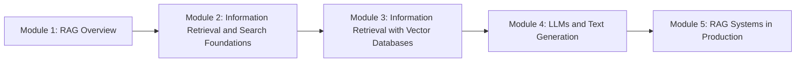

[!Draft|amber] Retrieval Augmented Generation (RAG).

## Course Content and Roadmap

| | |
|---|---|
| **Course** | Retrieval Augmented Generation (RAG) |
| **Level** | Intermediate |
| **Duration** | 26h3m |
| **Instructor** | Zain Hasan, DeepLearning.AI |
| **Content** | 49 Video Lessons · 9 Code Examples · 10 Graded Assignments PRO |
| **Updated** | Jul 23, 2026 |

[!Intermediate|blue] [!26h3m|gray] [!49 Video Lessons|green] [!9 Code Examples|amber] [!10 Graded Assignments PRO|purple]

### What you'll learn

::: cards
- **RAG for real-world applications**: Learn how retrieval and generation work together, and how to design each component to build reliable, flexible RAG systems.
- **Search techniques and vector databases**: Use techniques like keyword search, semantic search, hybrid search, chunking, and query parsing to support RAG applications across domains like healthcare and e-commerce.
- **Prompt design, evaluation, and deployment**: Craft prompts that make the most of retrieved context, evaluate RAG system performance, and prepare your pipeline for production.
:::

### The benefits of RAG

RAG helps large language models generate more accurate and useful responses by retrieving relevant information from knowledge bases of information they weren’t trained on. These sources of information are often private, recent, or domain-specific, which gives an LLM more context to provide grounded answers. In this course, you’ll learn how to design and implement every part of a RAG system, from retrievers and vector databases to large language models, and evaluation platforms. You’ll understand fundamental principles and apply key techniques at both the component and system levels to effectively connect LLMs to relevant external data sources.

### Why Enroll?

Large language models are powerful, but without access to the right information, they often make mistakes. RAG fixes that by grounding model responses in relevant, often private or up-to-date data. As LLMs move into real products and workflows, the ability to build robust, reliable RAG systems is becoming a must-have skill for engineers working in AI.

This course, taught by AI engineer and educator Zain Hasan, gives you the hands-on experience and conceptual understanding to design, build, and evaluate production-ready RAG systems.

You’ll learn to choose the right architecture for your use case, work with vector databases like Weaviate, experiment with prompt and retrieval strategies, and monitor performance using tools like Phoenix from Arize.

Throughout the course, you’ll build progressively more advanced components of a RAG system, using real-world datasets from domains like e-commerce, media, and healthcare. You’ll also explore critical tradeoffs, like when to use hybrid retrieval, how to manage context window limits, and how to balance latency and cost, preparing you to make informed engineering decisions in practice.

RAG is at the core of LLM systems that need to be accurate, grounded, and adaptable, whether for internal tools, customer-facing assistants, or specialized applications. This course helps you move beyond proof-of-concept demos into real-world deployment, equipping you with the skills to build, evaluate, and evolve RAG systems as the ecosystem grows.

::: statement
**Start building RAG systems designed for real-world use.**
:::

::: success
You’ll earn a certificate upon completing the course, recognizing your skills in building and evaluating RAG systems with real-world tools and techniques
:::

### Instructor

::: note {color=indigo icon=star} Zain Hasan
Senior AI/ML Developer Relations Engineer at Together.ai, AI/ML Researcher and Lecturer at the University of Toronto
:::

### Recommended Background

::: prereq
Intermediate Python skills required; basic knowledge of generative AI and high school–level math is helpful.
:::

### Learn through real-world projects

Across five modules, you’ll complete hands-on programming assignments that guide you through building each core part of a RAG system, from simple prototypes to production-ready components.

Through hands-on labs, you’ll:

::: steps
1. Build your first RAG system by writing retrieval and prompt augmentation functions and passing structured input into an LLM.
2. Implement and compare retrieval methods like semantic search, BM25, and Reciprocal Rank Fusion to see how each impacts LLM responses.
3. Scale your RAG system using Weaviate and a real news dataset—chunking, indexing, and retrieving documents with a vector database.
4. Develop a domain-specific chatbot for a fictional clothing store that answers FAQs and provides product suggestions based on a custom dataset.
5. Improve chatbot reliability by handling real-world challenges like dynamic pricing and logging user interactions for monitoring and debugging.
6. Develop a domain-specific chatbot using open-source LLMs hosted by Together AI for a fictional clothing store that answers FAQs and provides product suggestions based on a custom dataset.
:::

### Roadmap

| Module | Videos | Code Examples | Graded |
|---|---|---|---|
| Module 1: RAG Overview | 8 | 2 | 2 |
| Module 2: Information Retrieval and Search Foundations | 10 | 2 | 2 |
| Module 3: Information Retrieval with Vector Databases | 9 | 2 | 2 |
| Module 4: LLMs and Text Generation | 11 | 2 | 2 |
| Module 5: RAG Systems in Production | 11 | 1 | 2 |
| **Total** | **49** | **9** | **10** |

### Course Outline

#### Module 1: RAG Overview

| Section | Lesson | Type | Time |
|---|---|---|---|
| **RAG Overview** | A conversation with Andrew Ng | 🎬 Video | 8m |
|  | Module 1 introduction | 🎬 Video | 1m |
|  | Introduction to RAG | 🎬 Video | 5m |
|  | Applications of RAG | 🎬 Video | 4m |
|  | RAG architecture overview | 🎬 Video | 5m |
|  | Introduction to LLMs | 🎬 Video | 9m |
|  | - A brief Python refresher | 💻 Code Example | 10m |
|  | LLM Calls and Crafting Simple Augmented Prompts | 💻 Code Example | 10m |
|  | Introduction to information retrieval | 🎬 Video | 5m |
|  | [IMPORTANT] Have questions, issues or ideas? Join our Forum! | 📄 Reading | 2m |
| **Graded Assignments** | Module 1 Quiz | 📝 Graded・Quiz | 20m |
|  | Introduction to RAG systems | 🧪 Graded・Code Assignment | 3h |
| **Module 1 Wrap Up** | Module 1 conclusion | 🎬 Video | 1m |
|  | Lecture Notes M1 | 📄 Reading | 1m |

#### Module 2: Information Retrieval and Search Foundations

| Section | Lesson | Type | Time |
|---|---|---|---|
| **Information retrieval basics** | Module 2 introduction | 🎬 Video | 1m |
|  | Retriever architecture overview | 🎬 Video | 3m |
|  | Metadata filtering | 🎬 Video | 4m |
|  | Keyword search - TF-IDF | 🎬 Video | 7m |
|  | Keyword search - BM25 | 🎬 Video | 4m |
|  | Semantic search - introduction | 🎬 Video | 7m |
|  | Semantic search - embedding model deepdive | 🎬 Video | 6m |
|  | Vector embeddings in RAG | 💻 Code Example | 1h |
|  | Hybrid search | 🎬 Video | 7m |
|  | Evaluating retrieval | 🎬 Video | 8m |
|  | Retrieval metrics | 💻 Code Example | 1h |
| **Lecture Notes (Optional)** | Lecture Notes M2 | 📄 Reading | 1m |
| **Graded Assignments** | Module 2 Quiz | 📝 Graded・Quiz | 25m |
|  | Implementing retriever functions in a RAG system | 🧪 Graded・Code Assignment | 3h |
| **Module 2 Wrap Up** | Module 2 conclusion | 🎬 Video | 2m |

#### Module 3: Information Retrieval with Vector Databases

| Section | Lesson | Type | Time |
|---|---|---|---|
| **Information Retrieval with Vector Databases** | Module 3 introduction | 🎬 Video | 1m |
|  | Approximate nearest neighbors algorithms (ANN) | 🎬 Video | 7m |
|  | Vector databases | 🎬 Video | 5m |
|  | Introduction to the Weaviate API | 💻 Code Example | 1h |
|  | Chunking | 🎬 Video | 6m |
|  | Chunking | 💻 Code Example | 1h |
|  | Advanced chunking techniques | 🎬 Video | 5m |
|  | Query parsing | 🎬 Video | 5m |
|  | Cross-encoders and ColBERT | 🎬 Video | 8m |
|  | Reranking | 🎬 Video | 4m |
| **Lecture Notes (Optional)** | Lecture Notes M3 | 📄 Reading | 1m |
| **Graded Assignments** | Module 3 Quiz | 📝 Graded・Quiz | 30m |
|  | Building RAG Systems with a Vector Database | 🧪 Graded・Code Assignment | 1h30m |
| **Module 3 Wrap Up** | Module 3 conclusion | 🎬 Video | 1m |

#### Module 4: LLMs and Text Generation

| Section | Lesson | Type | Time |
|---|---|---|---|
| **LLMs and Text Generation** | Module 4 introduction | 🎬 Video | 1m |
|  | Transformer architecture | 🎬 Video | 8m |
|  | LLM sampling strategies | 🎬 Video | 8m |
|  | Exploring LLM capabilities | 💻 Code Example | 1h |
|  | Choosing your LLM | 🎬 Video | 8m |
|  | Prompt engineering: building your augmented prompt | 🎬 Video | 5m |
|  | Prompt engineering: advanced techniques | 🎬 Video | 8m |
|  | Prompt engineering | 💻 Code Example | 1h |
|  | Handling hallucinations | 🎬 Video | 7m |
|  | Evaluating your LLM's performance | 🎬 Video | 5m |
|  | Agentic RAG | 🎬 Video | 6m |
|  | RAG vs. Fine-Tuning | 🎬 Video | 6m |
| **Lecture Notes (Optional)** | Lecture Notes M4 | 📄 Reading | 1m |
| **Graded Assignments** | Module 4 Quiz | 📝 Graded・Quiz | 30m |
|  | Developing a RAG-based Chatbot | 🧪 Graded・Code Assignment | 1h |
| **Module 4 Wrap Up** | Module 4 conclusion | 🎬 Video | 1m |

#### Module 5: RAG Systems in Production

| Section | Lesson | Type | Time |
|---|---|---|---|
| **RAG Systems in Production** | Module 5 introduction | 🎬 Video | 1m |
|  | What makes production challenging | 🎬 Video | 3m |
|  | Implementing RAG evaluation strategies | 🎬 Video | 7m |
|  | Logging, monitoring, and observability | 🎬 Video | 4m |
|  | Tracing a RAG system | 💻 Code Example | 1h |
|  | Customized evaluation | 🎬 Video | 5m |
|  | Quantization | 🎬 Video | 7m |
|  | Cost vs Response Quality | 🎬 Video | 5m |
|  | Latency vs Response Quality | 🎬 Video | 4m |
|  | Security | 🎬 Video | 5m |
|  | Multimodal RAG | 🎬 Video | 6m |
| **Lecture Notes (Optional)** | Lecture Notes M5 | 📄 Reading | 1m |
| **Graded Assignment** | Module 5 Quiz | 📝 Graded・Quiz | 33m |
|  | [IMPORTANT] Reminder about End of Access to Lab Notebooks | 📄 Reading | 10m |
|  | Improving the ChatBot | 🧪 Graded・Code Assignment | 3h |
| **Module 5 Wrap Up** | Module 5 conclusion | 🎬 Video | 1m |

#### Community Opportunities

| Section | Lesson | Type | Time |
|---|---|---|---|
| **Community Opportunities** | Opportunity to mentor other learners | 📄 Reading | 5m |
|  | Acknowledgments | 📄 Reading | 10m |

### Frequently Asked Questions

::: details How long is the course?
The course is designed to be completed in about a month, with an estimated commitment of 5 hours per week.
:::

::: details Can I take this course at my own pace?
Yes, the course is designed to be self-paced.
:::

::: details What kind of support is available?
Access to discussion forums, detailed documentation, and resources to support your learning.
:::

::: details Is there a certificate upon completion?
You will receive a certificate at the end of the course if you pay or receive financial aid for it and complete the assessments. There is a limit of 180 days of certificate eligibility, after which you must re-purchase the course to obtain a certificate. If you audit the course for free, you will not receive a certificate.
:::

::: details I have questions about my subscription of this Professional Certificate, whom can I ask?
Please use the Coursera Learner Help Center for questions about your subscription.
:::

::: details Can I apply for financial aid?
Yes, Coursera provides financial aid to learners who cannot afford the cost of a subscription.
:::

::: details Can I preview this course?
Yes! You can preview the course for free by accessing the entire first module at no cost. This allows you to explore the learning experience before deciding if you’d like to continue. If you want full access to all modules, assessments, and the certificate of completion, you’ll need to upgrade to the paid version.
:::

## Module 1: RAG Overview

### A conversation with Andrew Ng

What RAG is, why it matters, where it is used, and how it is evolving toward agentic RAG.

#### Key terms

| Term | Meaning |
|---|---|
| RAG (Retrieval Augmented Generation) | The most widely used technique for improving the quality and accuracy of an LLM's response, by giving the model access to additional data |
| Proprietary data | Your own documents and data, which the LLM was not trained on |
| Grounded response | An answer based on the documents or context the LLM is given, not only its training data |
| Hallucination | When an LLM states something that is not supported by its data or context |
| Context window | How much input text an LLM can take in at once |
| Chunking / chunk size | Cutting a long document into pieces, and how big those pieces are |
| Hyperparameter | A design setting you tune, such as chunk size or how many pieces to retrieve |
| Reasoning models | LLMs that can reason over the provided context to answer more complex questions |
| Agentic document extraction | Technology that extracts content from PDFs, slides and other documents so RAG can use them |
| Agentic RAG | Systems where LLM agents decide for themselves what data to retrieve, and when |
| Vector database | A key component of RAG that stores and searches data for retrieval. Weaviate is one |
| Fine-tuning | Further training a model on your data. An alternative to RAG |
| Long context models | LLMs with large context windows, another alternative weighed against RAG |

#### What RAG does

An LLM starts off knowing only what it was trained on, often public internet data. To answer questions with facts from **proprietary data**, such as your own documents, RAG gives the model access to that additional data, so it can answer with facts it was not trained on.

::: example
When a chatbot like ChatGPT, Claude or Gemini tells you it is **searching the web** to answer your question, the LLM is accessing additional information so its response is up to date and accurate.
:::

#### The core idea

::: definition RAG
Pairing **classical search systems** with the **reasoning abilities of large language models**.
:::

The concept isn't complex, but there are a huge number of ways to implement it, and **design choices make a huge difference** to the accuracy and speed of your system. A high-performing RAG system needs you to:

::: steps
1. Prepare your data for use in the system.
2. Prompt your language model to get the most out of that data.
3. Evaluate actual user traffic to make sure you are providing high-quality responses.
:::

#### Where RAG is used

Andrew thinks RAG may be **the most commonly built type of LLM-based application in the world today**.

| Who | Use |
|---|---|
| Large companies | Help customers get answers about their products |
| Large companies | Help employees get answers about internal policies and other matters |
| Startups: healthcare | Answer medical questions |
| Startups: education | Tutor students on a range of subjects |

#### How RAG is evolving with LLMs

As LLM technology improves, RAG systems rapidly incorporate it:

- **Better grounding:** recent models are much better than those from one or two years ago at staying grounded in the documents or context given. Over the last year or so, RAG hallucination rates have been trending steadily down.
- **Reasoning models:** RAG systems can tackle much more complex questions by reasoning on top of the provided context.
- **Larger context windows:** best practices for what to insert, how to cut documents into pieces, and what goes into the input context keep evolving, because you no longer have to squeeze so much into a tiny context window.
- **Agentic document extraction:** you can more easily build RAG on PDF files, slides and other document types, so systems can ingest and answer questions over broader sets of materials.
- **RAG inside agentic workflows:** in complex multi-step workflows, RAG is often one component. At step five or step seven of an enterprise workflow, it gives the agent the information it needs to process a document or reason about a customer request.

::: quote Zain Hasan
Even as the AI field continues to evolve rapidly, I don't think RAG's going anywhere. LLMs will continue to benefit from access to high quality relevant data.
:::

#### Agentic RAG

Agentic RAG uses multiple LLMs, each handling one part of a large workflow, with the agency to decide what data to retrieve. It is at the frontier of how companies push the performance of LLM-based applications. Other advanced techniques include **multimodal** and **reasoning models**, and balancing RAG against **fine-tuning** and newer **long context models**.

::: compare
**Earlier RAG:** a human engineer writes code and rules that decide how to cut a long document into pieces, how to retrieve them, and how many pieces (say seven) to put into the LLM's context.
---
**Agentic RAG:** an AI agent is given retrieval tools and decides for itself. Should it do a web search next, and with what keywords? Query a specialized database? Is the first round of information good enough, or does it need a second round?
:::

This makes systems much more **flexible and powerful**, and helps them deal with the messiness of the real world: when they make a mistake, they can route back and fix their approach.

#### From basic RAG to agentic RAG

Building RAG well covers the whole range, from basic RAG to advanced agentic RAG:

- **Core principles and mental frameworks** for how to build these systems.
- **Practicalities**, such as tuning the hyperparameter of the appropriate **chunk size** to cut a very long document into, and how to **manage context**.
- **Components beyond RAG:** many of the components that go into RAG are useful for other generative AI applications you may build.
- **A foundation** for assembling the generative AI tools now available into an application, evaluating it, and driving continued improvements.

::: takeaway
RAG pairs search with LLM reasoning to ground answers in data the model wasn't trained on. It is simple in concept but full of design choices, and it is moving toward **agentic RAG**, where agents decide what to retrieve.
:::

Next: the main components of a RAG system.
