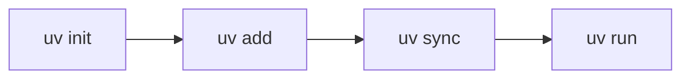

## 1. Application layout

The app has four areas. Everything else in this Reference lives inside one of them.


| Area | What it holds |
|---|---|
| **Top bar** | Logo, version badge, menu (REFERENCE opens this page), account |
| **Left panel** | Progress, Recent Lectures, New Lecture, All Lectures tree |
| **Lecture area** | Title, date, save state, Edit mode bar, the current step, pager |
| **Right panel** | Resources, Export, More. The arrow tab hides or shows it |

### Top bar


| Control | What it does | Status |
|---|---|---|
| AI4Free logo + V3 badge | Shows the app and its version | Works |
| TECH, FAQS, BLOG | Placeholder links | Mock |
| REFERENCE | Opens this page. **Back to lectures** returns to where you were | Works |
| Account | Shows the signed-in user | Mock (training account) |

## 2. Left panel


| Control | What it does | Status |
|---|---|---|
| Progress bar | Steps completed in the open session | Works |
| Recent Lectures | The last 5 sessions you opened, newest first | Works |
| New Lecture | Creates an empty session (this visit only) | Works |
| All Lectures | Every session; the arrow opens its steps | Works |
| Step list | Click a step to open it. A green mark means completed | Works |
| Show more / Show earlier steps | Long sessions show 8 steps at a time | Works |

## 3. Lecture area

### Header

| Element | What it shows |
|---|---|
| Title | The session title (Rename File changes it) |
| Date | When the session was created |
| Save state | Where edits are saved: shared copy, this browser session, or view only |
| Edit mode switch | Turns on the pencil on each section |
| Advanced editor | Opens the full editor (see section 13) |

### One step per view

Each `##` heading in a session file is one step. Only the current step shows, with the session introduction on step 1.

### Pager and completion


| Control | What it does | Status |
|---|---|---|
| Step N of M | Where you are in the session | Works |
| Mark complete & continue | Marks the step done and opens the next one. **Undo** reverses it | Works |
| Previous / Next | Move one step. Keyboard: left and right arrows | Works |
| Ready for the Next Lesson | Banner on the last step | Mock button |

## 4. Right panel


### Resources


| Part | What it does |
|---|---|
| For this step | Links and files listed for the current step |
| All session resources | Every link and file in the session, one click to open |
| Link entry | Opens the page in a new tab; shows the site name |
| File entry | Downloads the file; shows type and size |

Resources are set per session in `lectures/index.json`:

```json title="index.json"
"resources": [
  { "title": "Git documentation", "url": "https://git-scm.com/doc", "note": "Official Git reference and book.", "steps": ["2"] },
  { "title": "gitignore.txt", "file": "assets/files/step2/gitignore.txt", "size": "1 KB", "note": "Full .gitignore after Step 2", "steps": ["2"] }
]
```

`steps` uses the step badge: `"2"` for "Step 2: ...", `"12.3"` for "12.3 ...".

### Export

| Control | What it does | Status |
|---|---|---|
| Download PDF | Prints the page to PDF | Works outside Claude. Inside Claude: use Download HTML, then print |
| Print | Friendly, Notebook study sheet, Sketchnote poster, Binder notes, Handwritten notes; current lecture or whole session | Works |
| Download DOCX | Word-compatible file of the lecture, images included | Works |
| Download TXT | Plain text of the lecture | Works |
| Download HTML | One offline file with every session and saved edits | Works |
| Advanced Export | MD, JSON, DOCX or TXT with options | Works |


### More

| Control | What it does | Status |
|---|---|---|
| AI Assistant | Summaries by length and tone; notes as image, HTML or DOCX | Works inside Claude only |
| Translate | Language picker | Mock |
| Share Lecture | Copies the page link (not the exact lecture) | Partial |
| Edit mode | Same switch as above the lecture | Works |
| Advanced editor | Same as above the lecture | Works |
| Download Audio | Fixed size label, no file | Mock |
| Rename File | Renames the session title | Works |
| Delete File | Hides the session for this visit | Works, wording is out of date |


## 5. Buttons

Every button type in the app, shown live. The samples on this page do nothing when clicked.

{{ui-buttons}}

House rules:

- One primary button (`btn`) per dialog, on the right; Cancel or Close is `btn ghost` on its left.
- Use `btn red` only for actions that remove something.
- Use green (`btn-done`, `save`) only for completing or saving.

## 6. Colors

### App colors

{{ui-tokens}}

### Content colors

Twelve named colors, usable in text, backgrounds, badges and callouts.

{{ui-colors}}

```text title="Syntax"
{red|Text color}            text color
{bg-red|Background}         background highlight
{#e11d48|Any hex color}     exact color by hex code
[!New|green]                badge
::: note {color=purple}     callout in a custom color
```

## 7. Text and inline formatting

### Headings

Live: the headings of this page. `##` starts a new step (or a Reference section here), `###` a sub-section, `####` a small heading.

```text title="Syntax"
## Step 3: Create the project
### 3.1 Install uv
#### Details
```

### Inline styles

**Bold**, *italic*, __underline__, ~~strikethrough~~, ==highlight==, `inline code`, [a link](https://docs.astral.sh/uv/), {red|red text}, {blue|blue text}.

```text title="Syntax"
**Bold**, *italic*, __underline__, ~~strikethrough~~, ==highlight==, `inline code`,
[a link](https://docs.astral.sh/uv/), {red|red text}, {blue|blue text}
```

Colors: red, orange, amber, yellow, green, teal, blue, indigo, purple, pink, gray, brand.

### Keyboard keys and badges

Press [[Ctrl]] + [[S]] to save. [!New|green] [!Beta|amber] [!Windows|blue] [!Draft|gray]

```text title="Syntax"
Press [[Ctrl]] + [[S]] to save. [!New|green] [!Beta|amber] [!Windows|blue] [!Draft|gray]
```

### Lists

- A bullet item
- Another bullet item

1. A numbered item
2. Another numbered item

```text title="Syntax"
- A bullet item
- Another bullet item

1. A numbered item
2. Another numbered item
```

### Table

| Command | What it does |
|---|---|
| `uv add` | Adds a dependency |
| `uv sync` | Installs from the lockfile |

```text title="Syntax"
| Command | What it does |
|---|---|
| `uv add` | Adds a dependency |
| `uv sync` | Installs from the lockfile |
```

### Plain quote and divider

> A plain quote starts with `>`.

---

```text title="Syntax"
> A plain quote starts with `>`.

---
```

## 8. Callouts

Seventeen callout types. Each is `::: type Optional title` ... `:::`.

::: info
Neutral background information.
:::

::: tip
A shortcut or a smarter way.
:::

::: note
A side note.
:::

::: success
The expected result.
:::

::: warning
Something that can go wrong.
:::

::: danger
Something that causes damage or leaks secrets.
:::

::: example
`uv run python main.py` runs a file in the project environment.
:::

::: objective
What the learner will be able to do.
:::

::: prereq
What must be done before this step.
:::

::: important
Something the learner must not skip.
:::

::: best
The recommended way.
:::

::: mistake
A common mistake and its fix.
:::

::: definition Lockfile
A file that records the exact version of every package.
:::

::: takeaway
The one idea to remember.
:::

::: exercise
A task for the learner.
:::

::: question
A question to check understanding.
:::

::: note {color=purple icon=rocket} Custom color and icon
Any callout can take `{color=... icon=...}`.
:::

```text title="Syntax"
::: info
Neutral background information.
:::

::: definition Lockfile
A file that records the exact version of every package.
:::

::: note {color=purple icon=rocket} Custom color and icon
Any callout can take {color=... icon=...}.
:::
```

Types: info, tip, note, success, warning, danger, example, objective, prereq, important, best, mistake, definition, takeaway, exercise, question.
Icons: rocket, star, bolt, flag, shield, key, clock, book, terminal, heart, check, x, plus every type name.

## 9. Layout blocks

### Steps

::: steps
1. Install uv.
2. Create the project.
3. Add a package.
:::

```text title="Syntax"
::: steps
1. Install uv.
2. Create the project.
3. Add a package.
:::
```

### Cards

::: cards
- **Fast**: installs packages in seconds.
- **Reproducible**: the lockfile pins every version.
- **All in one**: Python versions, environments and tools.
:::

```text title="Syntax"
::: cards
- **Fast**: installs packages in seconds.
- **Reproducible**: the lockfile pins every version.
- **All in one**: Python versions, environments and tools.
:::
```

### Compare (before / after)

::: compare
`pip install rich` installs the package but records nothing.
---
`uv add rich` installs it and records it in `pyproject.toml` and `uv.lock`.
:::

```text title="Syntax"
::: compare
`pip install rich` installs the package but records nothing.
---
`uv add rich` installs it and records it in `pyproject.toml` and `uv.lock`.
:::
```

### Do and don't

::: dodont
- Commit `pyproject.toml` and `uv.lock`
---
- Commit the `.venv/` folder
:::

```text title="Syntax"
::: dodont
- Commit `pyproject.toml` and `uv.lock`
---
- Commit the `.venv/` folder
:::
```

### Columns

::: columns Option A|Option B
Build the scaffold by hand.
---
Use `uv init`.
:::

```text title="Syntax"
::: columns Option A|Option B
Build the scaffold by hand.
---
Use `uv init`.
:::
```

Compare and do/don't take custom headings the same way: `::: compare Old|New`.

### Collapsible

::: details Deep dive: why lockfiles matter
Without a lockfile, two developers can install different versions.
:::

::: details {open} Open by default
Add `{open}` to start expanded.
:::

```text title="Syntax"
::: details Deep dive: why lockfiles matter
Without a lockfile, two developers can install different versions.
:::

::: details {open} Open by default
Add {open} to start expanded.
:::
```

### Quote with author and statement

::: quote AI4Free course team
Reproducible environments turn "it works on my machine" into "it works on every machine".
:::

::: statement
**One project, one environment, one lockfile.**
:::

```text title="Syntax"
::: quote AI4Free course team
Reproducible environments turn "it works on my machine" into "it works on every machine".
:::

::: statement
**One project, one environment, one lockfile.**
:::
```

## 10. Interactive blocks

Learner answers are saved per learner (in this browser outside Claude).

### Quiz

::: quiz {id=ref-quiz} Quiz Question
Which file should you never edit by hand?

- [ ] pyproject.toml
- [x] uv.lock
- [ ] README.md
---
`uv.lock` is written by uv. Change it with `uv add`, `uv remove` or `uv lock`.
:::

```text title="Syntax"
::: quiz {id=unique-id} Quiz Question
Which file should you never edit by hand?

- [ ] pyproject.toml
- [x] uv.lock
- [ ] README.md
---
Explanation shown after the learner submits.
:::
```

`[x]` marks the correct option. More than one `[x]` means any of them counts as correct. Text after `---` is the explanation.

### Free response

::: response {id=ref-response} Your turn
Write one sentence on why a lockfile matters.
:::

```text title="Syntax"
::: response {id=unique-id} Your turn
Write one sentence on why a lockfile matters.
:::
```

### Checklist

::: checklist {id=ref-checklist} Step checklist
- [ ] uv installed
- [ ] Project created
- [ ] First package added
:::

```text title="Syntax"
::: checklist {id=unique-id} Step checklist
- [ ] uv installed
- [ ] Project created
- [ ] First package added
:::
```

Ticking every item and pressing Submit marks the step complete.

### Answer and solution

::: question
Which command installs from the lockfile?
:::

::: answer
`uv sync`
:::

::: solution
```bash
uv sync --locked
```
:::

```text title="Syntax"
::: answer
`uv sync`
:::

::: solution
​```bash
uv sync --locked
​```
:::
```

### Matching (drag and drop)

::: match {id=ref-match} Quiz Question
Match each uv command with what it does.

heads: Command | What it does
- uv add => Adds a package to the project
- uv sync => Installs what the lockfile lists
- uv run => Runs a command in the project environment
extra: Deletes the project | Upgrades Python
:::

```text title="Syntax"
::: match {id=unique-id} Quiz Question
Question text.

heads: Left column title | Right column title
- left item => its answer
- left item => its answer
extra: wrong answer | wrong answer
:::
```

Learners drag each answer (or click it, then click a slot) and press Submit. `extra:` adds answers that match nothing. `heads:` is optional.

### Solution walkthrough

::: walkthrough {id=ref-wt} The upgraded agent
```python
class FactCheckerAgent(Agent):
    suspicious_keywords = ["error", "uncertain"]

    def run(self, text):
        flags = [kw for kw in self.suspicious_keywords if kw in text.lower()]
        return {"text": text, "flags": flags}
```
@step lines=5
The core of the solution is one list comprehension.
@step lines=2,5
It loops through each keyword in `suspicious_keywords`.
@step lines=6
The flags found are returned with the text.
:::

```text title="Syntax"
::: walkthrough {id=unique-id} Title
​```python
...solution code...
​```
@step lines=5 at=02:09
Explanation for this step (any text, lists, code).
@step lines=2,5
Next step.
@step lines=6-9
Last step.
:::
```

Each `@step` highlights its `lines=` (numbers and ranges) in the code and dims the rest. Prev, Next and the dots move through the steps. `at=` is optional: it adds a "Video at" button that jumps to that time in the lecture's video block. Use it for exercise solutions, and put the solution code only here, not again elsewhere on the page.

## 11. Code blocks

### Basic code block with title

```python title="main.py"
from fastapi import FastAPI

app = FastAPI()
```

```text title="Syntax"
​```python title="main.py"
from fastapi import FastAPI

app = FastAPI()
​```
```

Languages: bash, python, js, ts, json, yaml, toml, sql, html, css, dockerfile, powershell, text, and more. Every block has a Copy button.

### Highlighted lines and line numbers

```python title="main.py" {3} numbers
from fastapi import FastAPI

app = FastAPI()
```

```text title="Syntax"
​```python title="main.py" {3} numbers
from fastapi import FastAPI

app = FastAPI()
​```
```

`{3}` highlights line 3; `{2-4,7}` highlights several. `numbers` adds line numbers.

### Tabs (command and output, or one per OS)

::: tabs
```bash title="Command"
uv --version
```
```text title="Output"
uv 0.8.0
```
:::

```text title="Syntax"
::: tabs
​```bash title="Command"
uv --version
​```
​```text title="Output"
uv 0.8.0
​```
:::
```

House rule: short tab labels (Command, Output, macOS / Linux, Windows). A description goes as text above the block.

### Terminal, diff and file tree

```terminal
$ uv --version
uv 0.8.0
```

```diff
 [project]
-dependencies = []
+dependencies = ["rich>=13"]
```

```tree
my-project/
├── pyproject.toml   # new
└── src/
    └── main.py
```

```text title="Syntax"
​```terminal
$ uv --version
uv 0.8.0
​```

​```diff
 [project]
-dependencies = []
+dependencies = ["rich>=13"]
​```

​```tree
my-project/
├── pyproject.toml   # new
└── src/
    └── main.py
​```
```

### Diagram (Mermaid)



```text title="Syntax"
​```mermaid
flowchart LR
  A[uv init] --> B[uv add] --> C[uv sync] --> D[uv run]
​```
```

Needs an internet connection the first time (the diagram library loads from the web).

## 12. Media

### Image with caption


```text title="Syntax"

```

Images live in `assets/images/`. The text in quotes is the caption; the alt text describes the image for screen readers.

### Video with chapters and transcript

::: video {id=ref-video} Demo: Sequential Agentic Workflow in Python
transcript: assets/transcripts/aw4-demo.srt
chapters:
- 00:00 Agents at the heart of the workflow
- 00:53 Research, summarizer and fact-checker agents
- 01:41 Running the agents step by step
:::

```text title="Syntax"
::: video {id=unique-id} Video title
src: assets/videos/name.mp4
transcript: assets/transcripts/name.srt
chapters:
- 00:00 First chapter
- 02:10 Next chapter
:::
```

| `src:` | What works |
|---|---|
| MP4 file (under 15 MB) in `assets/videos/` | Chapters and transcript lines jump the video; the current line follows playback |
| YouTube link | Chapters restart the video at that time; the transcript is for reading |
| Google Drive link | The video plays; chapters and transcript are for reading |
| No `src:` yet | Chapters and transcript are shown, with "Video not added yet" |

`transcript:` takes an `.srt` file (timed, clickable lines) or a `.txt` file (plain paragraphs). A lecture can have several video blocks.

## 13. Editor

### Edit mode


Turn on **Edit mode**, then click the pencil on a section to edit only that section in place. Save or Cancel under the text box.

### Advanced editor


| Part | What it does |
|---|---|
| Editing | Picks the step to edit |
| Toolbar | Heading, bold, italic, underline, highlight, inline code, color, background, code block, lists, divider |
| + Insert block | Inserts any block from this Reference |
| ? Syntax | Short syntax help |
| Preview / Original / Changes | Live preview, the file version, and the differences |
| History | Earlier versions of the step; Restore any of them |
| Discard / Save all | Throw away or save every change. Keyboard: Ctrl+S saves, Esc closes |

### How saved edits work

- A saved edit replaces that step of the lecture file when the page shows it.
- Inside Claude, edits are shared with everyone who opens the page; outside Claude they last until reload.
- Unsaved text is kept as a draft in the browser and offered back next time.

## 14. Session files

### File and index

| File | Holds |
|---|---|
| `lectures/index.json` | The session list: id, title, created date, file, step titles, resources |
| `lectures/NN-name.md` | One session: the introduction, then one `##` heading per step |
| `assets/images/` | Images used in lectures |
| `assets/files/` | Files listed as resources |

### Step headings

```text title="Syntax"
Introduction text shown on the first step.

## Step 1: Install uv
...
## 11.1 ReACT Prompting
...
```

`Step N:` shows the badge N; `11.1 Title` shows the badge 11.1; any other `##` heading is numbered in order. In a session that uses sub-numbers like `13.1`, a plain heading is the next main lecture, so Udacity headings need no `Step N:`.

### Udacity lecture pattern

Every Udacity lecture follows the same order:

1. `##` heading: the Udacity page title as is, with no `Step N:`.
2. Video block, when the lesson has a video: the `.srt` goes in its `transcript:` line, so the transcript appears once, only inside the video block. Chapters are written from the transcript.
3. The Udacity page text, as is, converted only to this viewer's blocks (callouts, code, lists).
4. Quizzes as on Udacity: one answer `[x]`, several answers (several `[x]`), or a `::: match` for drag and drop.
5. Exercise solutions as a `::: walkthrough`, using the page text split into steps that follow the solution code.
6. `### Conclusion` at the end, when there is a transcript: a short extracted version of it, in the speaker's voice, ending with a source line, e.g. `*Source: transcript of the lesson video "Title" (Udacity, course name).*`
7. Course Home: the lesson card lists the lecture numbers it links to.

